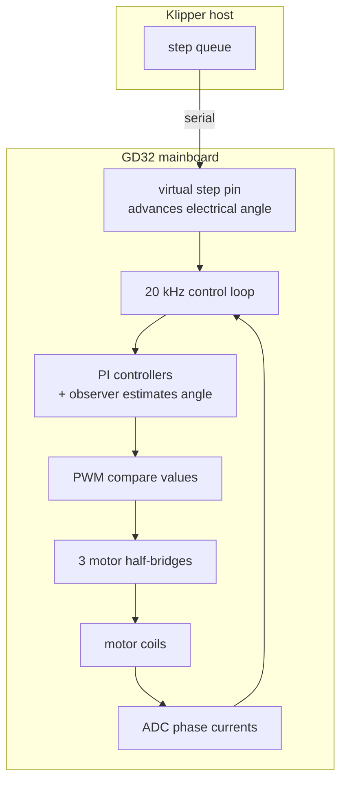

# Architecture

The full custom firmware effort has layers <small>*(like an onion!)*</small> The printer's Linux host runs
Klipper and web services. Four MCU boards perform motion, extrusion, heating,
and sensing. AFC models the removable tools and filament state. Printer-side
configuration ties those parts together.

| Layer | Current development role | Source |
| --- | --- | --- |
| Linux host | Runs Kalico (the Creator 5 Klipper fork), Moonraker, and the configured web interface. The printer is MIPS32 (Ingenic X2600 / Xburst 2 with 512MB of RAM) | [kalico](https://github.com/FlashForge-C5-Modding-Group/kalico) |
| Mainboard MCU | Handles the main motion and machine I/O through the GD32 port. Chip is a `gd32h737vgt6`. Also uses a "MCLib" motion library for complex stuff like VFA compensation. See [MCLib and motor control](#mclib-and-motor-control). | `kalico/src/c5_mainboardgd.c`, `c5_mclib.c` and related target code, `klippy/extras/mclib.py` |
| eboard MCU | Drives the shared physical extruder motor and supplies the pressure-advance measurement interface. Chip is `n32g455ccl7`. | `kalico/src/c5_eboard.c`, `c5_eboard_pa.c` and `klippy/extras/pa_adjust.py` |
| Heaterboard MCU | Handles tool heater and temperature I/O. Chip is `n32g455rel7`. | `kalico/src/stm32` N32G45x support (`C5_HEATERBOARD` build option) |
| Levelboard MCU | Supplies probe and levelboard-specific sensing used by calibration. Chip is `n32g430f8s7`. | `kalico/src/c5_levelboard.c` and Klippy levelboard code |
| Toolchanger and AFC | Uses physical dock and grab inputs for T0 to T3 selection. AFC standalone provides filament and tool mapping, while `creator5_toolchanger.py` owns the machine-specific motion and safety checks. | `kalico/klippy/extras` |
| Printer filesystem | Holds the Creator 5 configuration, AFC configuration, scripts, and printer data layout. | [opencreator-fs](https://github.com/FlashForge-C5-Modding-Group/opencreator-fs) |

## Printer-side layout

The SoC configuration is organized below `/usr/data/opencreator/klipper/configs` on the
printer. `printer.base.cfg` includes the Creator 5, probe, motor, filament,
vibration, Misc, and AFC files. G-code storage is configured at
`/usr/data/gcodes`. Stock-format calibration data remains under
`/usr/data/firmwareRes/config`, including `extruder.json`, `zoffset.json`, and
`test.json`. 

The Creator 5 has no chamber heater, chamber fans or aux fan, so those are in `printer.pro.cfg`. They're only
included on a Creator 5 Pro, through `printer.model.cfg`. On the printer, that file is written at every boot,
from the model in the stock boot script (`MACHINE=` in `/usr/prog/app_startup.sh`). In tunnel mode, the Pi
installer asks which printer it's connected to. On a Creator 5, `M106`/`M107 P2` and `P3` do nothing, and
`M191` says there's no chamber heater instead of failing.

The config layout is originally based on FlashForge's default config layout, just expanded with new macros, settings, and removals of useless settings.
This does not mean our config is interchangable with stock firmware, and if you try, it will not work as a lot of settings are intertwined with our Kalico.

There is one physical extrusion motor. The four Klipper extruder contexts
select the corresponding tool heaters and state; they are not four independent
extrusion drives. A toolchange must agree with the dock and grab pins before
the selected logical extruder becomes active.

The single motor driver is configured on the eBoard as identical
`[tmc2209 extruder]` through `[tmc2209 extruder3]` sections, one for each
logical extruder for CFW.
See [MCU development and verification](mcu-development.md) for pin assignments.


## MCLib and motor control

The X, Y and Z motors are not driven by stepper driver chips. The GD32
mainboard drives each motor's two windings directly from its timer channels,
and shapes the current itself. On stock firmware that shaping is
FlashForge/GigaDevice's closed-source **MCLib** motor control library,
loaded as `libmcu-bare.bin` from `/usr/prog`. Kalico ships a clean-room
replacement for it, written from observing what the stock library does;
the G-code commands keep their `MCLIB_*` names so existing config works.

### What MCLib replaces

Klipper normally tells a stepper driver "one step" and the chip handles the
rest. Here there is no driver chip between the MCU and the motor coils:

| | Driver-chip Klipper | Creator 5 mainboard |
|---|---|---|
| Steps | Driver chip microsteps internally | MCU generates the winding current waveforms |
| Current limit | Set by driver config | Closed-loop, controlled by firmware |
| Feedback | Usually none | Phase currents read back by ADC at 20 kHz |
| Lost steps | Invisible | Detectable in ours: the angle error is measured continuously |

So the step pins the config lists for X, Y and Z (`PJ0`–`PJ11`) are not
real GPIO. `c5_mainboardgd_gpio.c` maps them to virtual pins: writing
`X_STEP` calls `c5_mclib_step()`, which advances the motor's electrical
angle by one microstep; `X_DIR` sets the direction; `X_EN` enables or
disables the winding drive; and reading `X_ENDSTOP` (PJ3/PJ7) actually
returns the MCLib stall flag for that axis. Klipper's normal motion
planning, homing and endstop logic all work unchanged on top of this.

The extruder is *not* MCLib: it lives on the eBoard behind a TMC2209, as
described in [MCU development](mcu-development.md). Kalico's replacement
only covers the three mainboard motors.

### The control loop



At about 20 kHz, per motor:

1. Two ADC channels read the winding currents (`ia`, `ib`). The samples
   arrive by DMA into non-cached memory; a 2000-sample average first
   establishes the zero-current offset of each channel.
2. An **observer** (a current observer with high-frequency injection)
   estimates the motor's real electrical angle from the current history.
3. The estimated angle and the commanded angle (from the step pin) are
   compared. The error drives current PI controllers in the rotating d/q
   reference frame; the outputs go through an inverse transform back to
   per-winding voltages.
4. The voltages become PWM compare values for the motor's timer, which
   drives the half-bridges.

Between steps, `interpolate` moves the commanded angle smoothly (the step
interpolation in [Quieter motors](motor-noise.md)). When steps stop
arriving for a while the motor drops to `hold_current` on a ramp; the
currents decay to zero when disabled.

X and Y switch to a high-speed mode above a step-rate threshold (roughly
510 mm/s of belt travel): the speed controller takes over from the current
controllers and resonance compensation is not applied there.

### Configuring it

Each motor has a `[mclib stepper_*]` section next to its normal
`[stepper_*]`. Kalico sends it to the mainboard at connect time:

```ini
[mclib stepper_x]
motor_rs: 1.7     # winding resistance, ohm
motor_ls: 0.0026  # winding inductance, H
motor_km: 0.1729  # torque / back-EMF constant
bus_voltage: 24.0
run_current: 1.8
hold_current: 1.5
interpolate: True
```

The motor parameters set the PI gains and the observer model, so they
need to match the real motor (the BJ42D29-30V22/V23 values are in
`printer.base.cfg`). Runtime commands: `MCLIB_SET_CURRENT` changes the
currents, `MCLIB_SET_STALL` the stall threshold, and
`MCLIB_SET_RESONANCE_DAMP` / `MCLIB_APPLY_CALIBRATION` drive the
[VFA compensation](vfa-compensation.md) tables. Values found by
calibration are saved back into these sections by `SAVE_CONFIG`.

### Stall and slip detection

!!! note "Added by OpenCreator"
    Stock MCLib reports nothing; the observer's angle error is there for
    the control, but stock never watches it. This detection, and the
    guard below, are OpenCreator additions built on our replacement.

Because the observer measures the real angle, the mainboard can tell when
the motor isn't where it commanded it to be:

- **Stall**: filtered torque drops below `stall_threshold` while the
  motor is running (armed after 17 quarter-steps of motion, and off during
  hold transitions and slow motion). Reads as the axis "endstop" pin.
- **Slip**: the angle error drifts by whole electrical cycles (one cycle
  = four full steps), counted with hysteresis while moving.

The optional `[c5_motion_guard]` polls these counters twice a second over
a print, ignores homing and toolchange windows, and warns or pauses when
an axis loses steps (`C5_MOTION_STATUS` shows them). It needs mainboard
firmware with the `mclib_query_status` command.

### Firmware and updates

The replacement is the portable core in `src/c5_mclib.c` (no hardware
registers, unit-tested in `test/c5_mclib.c`) plus the hardware layer in
`src/stm32/c5_mainboardgd.c` that sets up the timers, ADCs and DMA.
`scripts/build_c5_update.py` builds the four board firmwares into stock
update packages, and validates that the mainboard build contains the
`config_mclib` command family and none of the commands the stock library
used (`mclib_set_pid_params`, `mclib_identify_motor`, ...), so a
half-updated board fails the build instead of the printer.

CPU faults are caught by `c5_mainboardgd_fault.c`, which turns the motor
PWM outputs off before reporting; an unhandled fault would otherwise
leave the windings energised.

## Interfaces

The printer configuration currently uses AFC standalone mode, not a BoxTurtle or AMS-like 
mechanism. Mainsail/Fluidd exposes virtual Misc switches for flow calibration and
purge. GrumpyScreen work is
separate from the core Klipper and filesystem repositories, and is mostly kept up to date and commited to mainline
SimpleAF GrumpyScreen.

## Hardware
Other than the previously explained hardware for the MCU chips, the printer
has some unexplained "maximum" limits for temperature

| Hardware | Default Max | Actual Max | Safe Max |
| --- | --- | --- | --- |
| Nozzles | 320c | 350c | 350c? |
| Chamber Heater (Pro) | 65c | 80c | 70c? |
| Bed | 120 | 130 | 125? |

Safe Max temps are the maximium safe temperatures before you run into actual
hardware limitations. Anything with a `?` may mean untested.

!!! danger "Known hardware limitations"
    - Above 70 degrees chamber temperature, the grill will deform
    - Above 320 degrees, the nozzle may start recording wildly off temperatures
