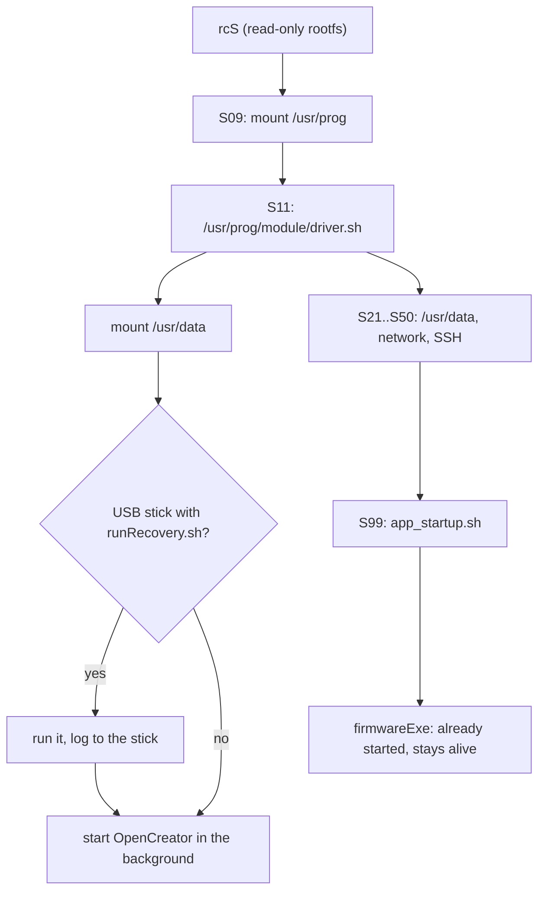

# Early boot and recovery stick

FlashForge updates overwrite `/usr/prog/app_startup.sh` and `firmwareExe`, the two files that normally start OpenCreator. So OpenCreator also boots from a file their updates never touch: `/usr/prog/module/driver.sh`. Stock's read-only rootfs runs it at every boot, long before `app_startup.sh`. The same file runs a recovery script from a USB stick, so a printer whose startup is broken can still be fixed without opening it up.

## Safer than stock

On a stock printer the only way to recover without opening it up is a FlashForge update on a USB stick. That check lives in `app_startup.sh`, the same script mods edit and FlashForge updates overwrite. If that script breaks (a bad edit, a mod, a write cut off by a power loss), the USB check goes with it, and the printer needs Ingenic USB boot, which means opening the electronics bay.

| What breaks | Stock | OpenCreator |
| --- | --- | --- |
| `app_startup.sh` (bad edit, mod, half-written) | no USB recovery, no Wi-Fi; open the printer | `driver.sh` still boots OpenCreator with Wi-Fi and SSH, and still runs `runRecovery.sh` from a stick |
| a FlashForge update replaces `app_startup.sh` and `firmwareExe` | n/a | `driver.sh` isn't touched; stock boots, as you asked for |
| OpenCreator's `firmwareExe` is deleted | n/a | `driver.sh` leaves it to `app_startup.sh`, which puts FlashForge's `firmwareExe` back (stock screen and Wi-Fi) |
| `driver.sh` itself is broken | n/a | stock's S11 just carries on; `app_startup.sh` boots OpenCreator the old way |

Other details that help:

- `driver.sh` runs from stock's read-only rootfs, which no update or mod can change.
- `driver.sh` and `firmwareExe` are written to a temporary file first and renamed into place, so a power loss never leaves half a file.
- A boot lock makes sure OpenCreator starts once, whichever of `driver.sh` and `app_startup.sh` gets there first.
- Klipper and the rest only start once Wi-Fi has an address (or after 15 s), so SSH is there when you need it.

## Boot order



`driver.sh` starts OpenCreator once `app_startup.sh` has set up `/etc` (or after 60 s if it never does). It loads the Wi-Fi, touch and coprocessor modules first, the same ones `app_startup.sh` loads. When `app_startup.sh` later starts `firmwareExe`, that copy sees OpenCreator is already running and only stays alive. If `app_startup.sh` is broken, or a FlashForge update replaced it, OpenCreator still boots.

`driver.sh` leaves the boot to `app_startup.sh` when:

| Condition | Why |
| --- | --- |
| `firmwareExe` is FlashForge's original program | stock was flashed or you rolled back |
| a FlashForge update (`Creator5*.tgz` or `runFirmwareExe.sh`) is on a USB stick | stock flashes it first |
| a control-board update is pending | stock updates the boards first |
| `firmwareExe` is an older OpenCreator one without the boot lock | it would start OpenCreator twice |

Before starting Klipper and the rest, `firmwareExe` waits until Wi-Fi has an address, at most 15 s. Without one it starts anyway, and keeps trying Wi-Fi in the background.

## Recovery stick

Put a `runRecovery.sh` in the root of a USB stick (FAT32, exFAT or ext4), plug it in and power the printer on. `driver.sh` runs it as root at every boot while the stick is in:

- before network, SSH and `app_startup.sh`, and even if `/usr/data` won't mount;
- from the stick's folder, with `$RECOVERY_DIR` set to it, so it can use files next to it;
- its output is added to `runRecovery.log` on the stick.

OpenCreator then boots as usual. Take the stick out when you're done, or make the script safe to run twice.

A script that saves the boot logs to the stick:

```sh
#!/bin/sh
OUT="$RECOVERY_DIR/recovery-$(date +%Y%m%d-%H%M%S)"
mkdir -p "$OUT"
dmesg > "$OUT/dmesg.txt"
cp /tmp/*.log "$OUT/" 2>/dev/null
cp /usr/prog/app_startup.sh* "$OUT/" 2>/dev/null
tail -n 2000 /usr/data/opencreator/klipper/logs/printer.log > "$OUT/printer.log" 2>/dev/null
sync
```

!!! warning
    The script runs as root with nothing in its way. Only use scripts you trust, and keep in mind that anyone with physical access can do the same.

FlashForge `.tgz` updates on a stick still install through stock's `app_startup.sh` as before.

## Files

| File on the printer | What | Installed by |
| --- | --- | --- |
| `/usr/prog/module/driver.sh` | the early boot hook stock runs at S11 | the installer, then the updater from `opencreator-fs` `firmware/driver.sh`; removed again by a rollback to stock |
| `/usr/prog/PROGRAM/software/firmwareExe` | OpenCreator's launcher (Wi-Fi, then the startup scripts) | the installer and the updater |
| `/usr/data/opencreator/firmware/` | the copies of both they install from | the installer and the updater |

| Log | What |
| --- | --- |
| `/tmp/early.log` | `driver.sh`: USB stick, and whether it started OpenCreator |
| `/tmp/opencreator.log` | `firmwareExe` and the startup scripts |
| `runRecovery.log` (on the stick) | the recovery script's output |

Technical details: [CREATOR5_EARLY_BOOT.md](https://github.com/FlashForge-C5-Modding-Group/opencreator-fs/blob/main/config-docs/CREATOR5_EARLY_BOOT.md) in opencreator-fs.
