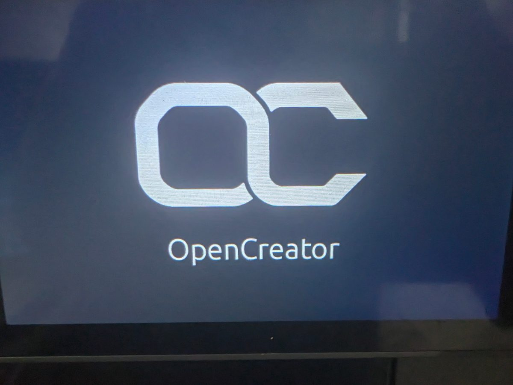
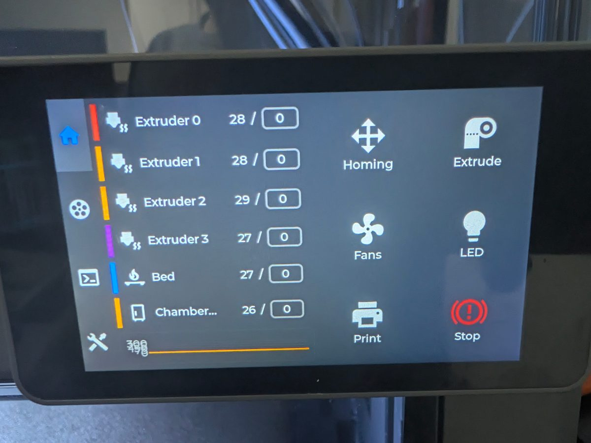
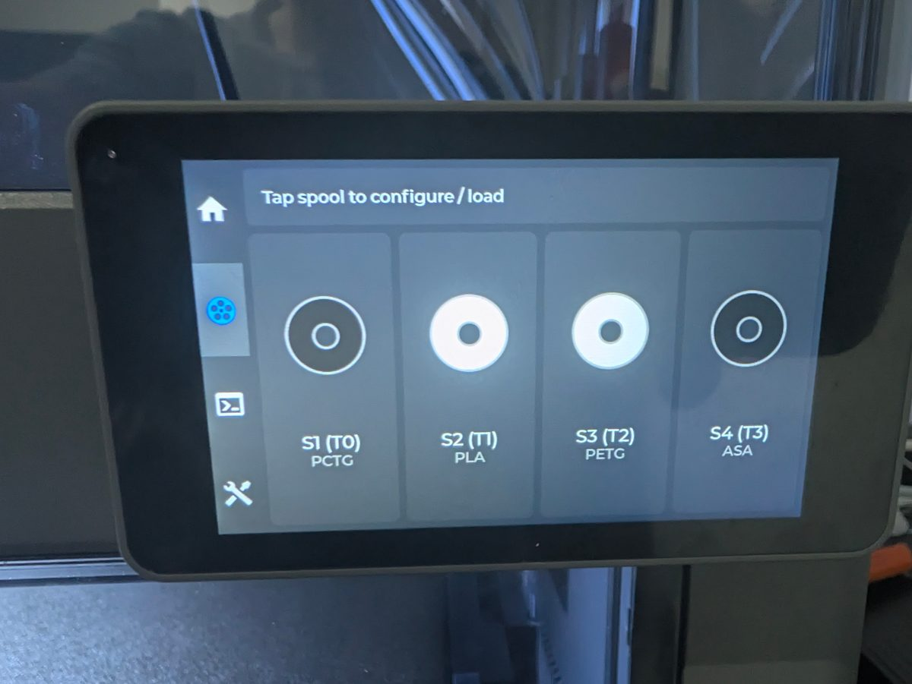

{ .oc-landing-mark }

# OpenCreator

Open-source custom firmware for the FlashForge Creator 5 and Creator 5 Pro.
{ .oc-lede }

Kalico (Klipper) on the printer, a real toolchanger, AFC filament handling and
Fluidd or Mainsail, all on the hardware you already own. Every part is open source
and can be changed.

[Get started](getting-started.md){ .md-button .md-button--primary }
[Latest release](https://github.com/FlashForge-C5-Modding-Group/OpenCreator/releases/latest){ .md-button }
[Discord](https://discord.gg/RsdkqDtfww){ .md-button }

Running a Raspberry Pi or another SBC? [OpenCreator for SBC](rpi-klipper.md)
runs the same stack there, with the printer's boards tunnelled over USB. Want to
stay close to stock? [OpenCreator Legacy](opencreator-legacy.md) works around
FlashForge's software instead of replacing it.

## Why OpenCreator?

-   :material-printer-3d-nozzle:{ .lg .middle } **Kalico on the printer**

    ---

    A Klipper fork with MPC heater tuning, input shaper graphs drawn on the
    printer, power loss recovery and timelapse.

-   :material-swap-horizontal-bold:{ .lg .middle } **A real toolchanger**

    ---

    Switch heads with `T0`–`T3`, load several tools in one go, and calibrate
    one nozzle without redoing all four.
    [See how fast it changes](different.md)

-   :material-printer-3d:{ .lg .middle } **Filament that knows itself**

    ---

    AFC with toolchanger support, ACE Pro auto feed and load, and material and
    colour synced into OrcaSlicer like an AMS.

-   :material-monitor-dashboard:{ .lg .middle } **Fluidd, Mainsail and GrumpyScreen**

    ---

    Full web control, so the touchscreen is optional. A faster camera stream,
    SFTP and 3MF uploads come with it.

-   :material-code-braces:{ .lg .middle } **Open and editable**

    ---

    Plain Klipper configs, toggles for every behaviour and a plugin system.
    [Every repository](project-layout.md) is on GitHub.

-   :material-account-group:{ .lg .middle } **Active community**

    ---

    Developers and Creator 5 owners in one place, for help, testing and what's
    next. [Join the Discord](https://discord.gg/RsdkqDtfww)

## Pick your edition

-   :material-chip:{ .lg .middle } **[OpenCreator CFW](opencreator-cfw.md)**

    ---

    Replaces FlashForge's software with Kalico, Moonraker and a web UI on the
    printer's own computer. The full feature set.

-   :material-raspberry-pi:{ .lg .middle } **[OpenCreator for SBC](rpi-klipper.md)**

    ---

    The same stack on a Raspberry Pi or other SBC, for more speed and room
    than the printer's MIPS board.

-   :material-history:{ .lg .middle } **[OpenCreator Legacy](opencreator-legacy.md)**

    ---

    Keeps the stock experience and adds comforts like a better camera. The
    lowest-risk start.

Not sure which one? [Is OpenCreator CFW for you?](is-cfw-for-you.md) walks
through what you gain and what you give up. The [feature list](cfwfeatures.md)
and [status and roadmap](status-and-roadmap.md) show what's finished and what's
still in testing.

## On the printer

[{ loading=lazy }](assets/images/oc-boot-logo.jpg "Boot logo")
[{ loading=lazy }](assets/images/grumpyscreen-home.jpg "GrumpyScreen home")
[{ loading=lazy }](assets/images/grumpyscreen-spools.jpg "GrumpyScreen spools")

!!! warning "Development software"
    Don't treat any full custom firmware from us as complete. What you've seen
    may be out of date, different, or not working. Wait unless you know exactly
    what you're doing and how to go back to stock.

!!! danger "Warranty and responsibility"
    OpenCreator's team and contributors take no responsibility for damage,
    wear or anything else that happens to your printer. If you brick or break
    it, that's on you, and installing mods may void your warranty. Be careful!
