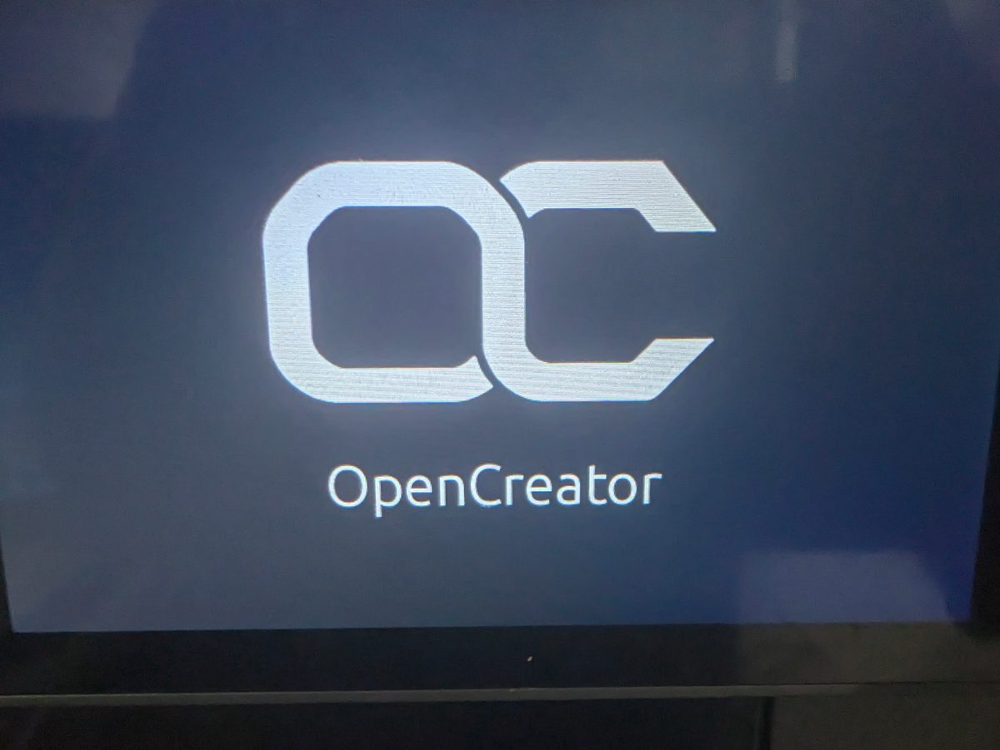
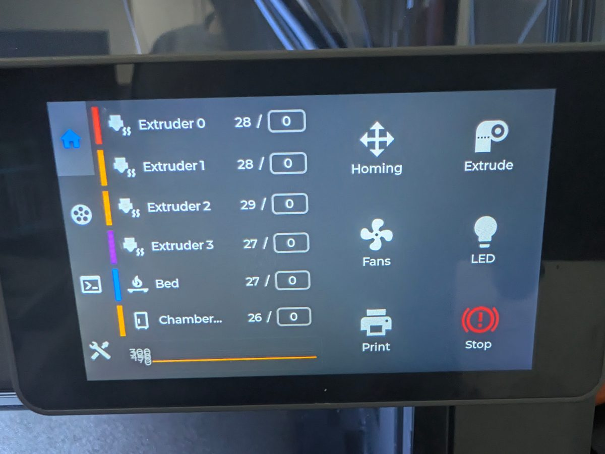
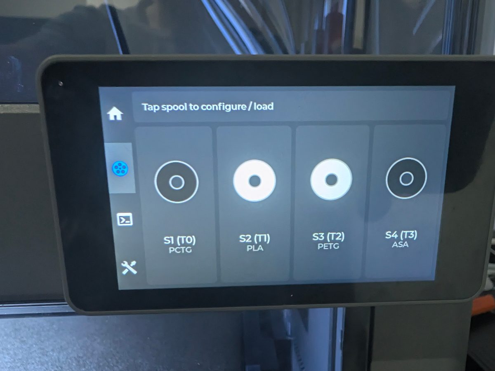

---
hide:
  - toc
---

# OpenCreator

OpenCreator is the FlashForge Creator 5 and Creator 5 Pro community full custom
firmware project. It brings the printer's four controller boards, Klipper host,
toolchanging, filament handling, and printer-side configuration into a
maintainable stack that is fully open source.

OpenCreator Legacy deals with older versions that keep a mostly stock experience,
whilst giving important creature comforts such as upgraded camera views.

[Get started](getting-started.md){ .md-button .md-button--primary }
[Download the latest release](https://github.com/FlashForge-C5-Modding-Group/OpenCreator/releases/latest){ .md-button }
[Join the Discord](https://discord.gg/RsdkqDtfww){ .md-button }

Join our [Discord](https://discord.gg/RsdkqDtfww) for updates on development,
support and a community of Flashforge Creator 5 / 5 Pro owners. We can even help
with alternate custom firmwares, even though support may be diminished.

## Start here

-   :material-help-circle: **[Is OpenCreator CFW for you?](is-cfw-for-you.md)**

    ---

    What you gain, what you give up, and when Legacy fits better.

-   :material-rocket-launch: **[Getting started](getting-started.md)**

    ---

    Decide between the stock-based Legacy path and development CFW.

-   :material-shield-alert: **[Installation and safety](installation-and-safety.md)**

    ---

    Download the latest release, and what you need to install it.

-   :material-progress-check: **[Status and roadmap](status-and-roadmap.md)**

    ---

    What works, what is being tested, and what is planned.

-   :material-printer-3d: **[Slicer Configuration for CFW](slicer-config.md)**

    ---

    Check out the needed slicer changes for CFW.

## Editions

-   :material-history: **[OpenCreator Legacy](opencreator-legacy.md)**

    ---

    The "Legacy" version of OpenCreator, which works around FlashForge instead of replacing it.

-   :material-chip: **[OpenCreator CFW](opencreator-cfw.md)**

    ---

    The newer replacement stack and its development goals.

-   :material-raspberry-pi: **[OpenCreator CFW for SBC](rpi-klipper.md)**

    ---

    OpenCreator running on a RPi or SBC instead of the host mips32 SOC.

-   :material-star-check: **[OpenCreator CFW Features](cfwfeatures.md)**

    ---

    OpenCreator features in general over stock.

## On the printer

[{ loading=lazy }](assets/images/oc-boot-logo.jpg "Boot logo")
[{ loading=lazy }](assets/images/grumpyscreen-home.jpg "GrumpyScreen home")
[{ loading=lazy }](assets/images/grumpyscreen-spools.jpg "GrumpyScreen spools")

## Technical reference

-   :material-sitemap: **[Architecture](architecture.md)**

    ---

    The host, four MCUs, AFC, touchscreen, and filesystem roles.

-   :material-memory: **[MCU development and verification](mcu-development.md)**

    ---

    The four boards, shared extruder driver, build checks, and outstanding printer tests.

-   :material-play-circle: **[Print workflow](print-workflow.md)**

    ---

    The current tool, heating, mesh, and nozzle-Z preparation sequence for CFW.

-   :material-tune-variant: **[General Printer Features](printer-features.md)**

    ---

    Toggles, macros and behaviors available on the printer.

-   :material-source-repository: **[Project layout](project-layout.md)**

    ---

    Find the source repositories.

!!! warning "Development software"
    Do not treat any full custom firmware from us as complete.
    Anything you may of seen may be out of date, different
    or just completely not working, and you should wait
    unless you know exactly what you are doing and how to revert.

!!! danger "Warranty & Responsibility Disclosure"
    OpenCreator's team and contributors do not take any responsibility over
    any damage, unintended wear, or anything else done to your printer
    and the responsibility is on you if you "brick" or break your printer,
    and installing mods may void your warranty, so of course, be careful!
