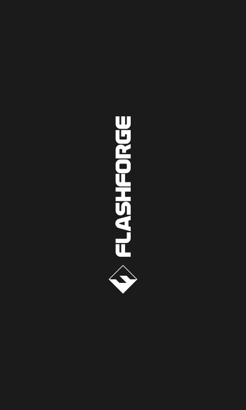

# Installation and safety

OpenCreator CFW is in public alpha. Download the
[latest release on GitHub](https://github.com/FlashForge-C5-Modding-Group/OpenCreator/releases/latest).

!!! warning "Alpha"
    This is an alpha. Expect bugs, keep a backup, and know how to go back to stock.
    Report problems on the [Discord](https://discord.gg/RsdkqDtfww).

CFW is installed with the [OpenCreator Installer](installer.md), a touchscreen app
that backs up the printer before changing anything. If you want a mostly stock printer
instead, use the [Legacy path](opencreator-legacy.md) and its own instructions.

## Supported FlashForge firmware

OpenCreator supports every FlashForge firmware version released for the Creator 5 and Creator 5 Pro,
from 1.7.8 up to the latest, 2.0.0. You don't need to update or downgrade before installing.

| FlashForge firmware | Kernel package |
| --- | --- |
| 1.7.8 to 1.9.7 | 2.0.1 to 2.0.5 |
| 1.9.8 | 2.0.6 |
| 1.9.9 | 2.0.7 |
| 2.0.0 | 2.0.8 |

A newer FlashForge release with a new kernel needs an installer update first; until then the installer
stops without changing anything. See [Supported kernel packages](installer.md).

## Requirements for USB

- [x] FAT32 Partition
- [x] At least 4GB in size 
- [x] USB is recommended to have at least 8GB for the backup step

## Requirement for printer
- [x] A printer that has at least 200MB on the prog partition and 1gb of storage on the data partition
- [x] A printer that has an active and stable internet connection of at least 1 mbps

## Steps to install OpenCreator

1. Download the zip from the [latest release](https://github.com/FlashForge-C5-Modding-Group/OpenCreator/releases/latest) and extract it to the root of the USB drive.
2. Reboot the printer with the USB drive plugged in.
3. Follow the on-screen steps. If you're not sure what "tunneled" means, choose a SoC install.
4. Wait about 15-30 minutes for the install (backing up takes the longest).
5. When it finishes, you'll be prompted to remove the USB drive and press reboot.
6. After rebooting you'll see the new boot logo and GrumpyScreen on the touchscreen, and Fluidd in your browser at the printer's IP.
7. Set up your slicer for OpenCreator: follow [Slicer Configuration](slicer-config.md) before your first print.

## Steps to update OpenCreator
There are two ways.

### Way 1: Fluidd/Mainsail
Fluidd and Mainsail have a way for smaller updates that don't affect most packages on the printer.

1. Navigate to the software update section
2. Update "OpenCreator" then "Klipper"
3. Reboot via switch or host restart

### Way 2: OpenCreator Installer Update
Sometimes an update can't be distributed like that, this is the other way for more major updates.

1. Load the update by copying files overtop the existing files
2. Plug in the USB drive and reboot
3. Update with backups or without backups (Backups will make it last significantly longer and are not required for updates)
4. Restart when it prompts you

## Uninstalling OpenCreator
To uninstall OpenCreator and go back to bone stock, launch the installer, and follow instructions for a `full rollback`

!!! warning "Files left over"
    Some files are left over after uninstalling. They can be removed manually:
    `/usr/data/opencreator`, `/usr/data/grumpyscreen`, and `/usr/data/python-hf`.

    Moonraker is also updated by OpenCreator, so if you go back to stock you'll need
    to reinstall FlashForge's original version from their download.

    If you picked Fluidd during install, you'll also need to revert Nginx to the stock config.

The [SSH login banner](installer.md#login-banner) doesn't need cleaning up: a
rollback removes it, and it turns itself off whenever FlashForge's firmware is
back in place.

### Restoring the stock boot logo
The OpenCreator boot logo will be removed when you use the full-rollback option. Here's a way if you do it via normal software updates.

1. Download the [stock logo](assets/images/stock-boot-logo.jpeg)
2. Copy it over `/usr/prog/logo.jpeg` on the printer, keeping that file name
3. Reboot the printer

[{ loading=lazy width=160 }](assets/images/stock-boot-logo.jpeg)
