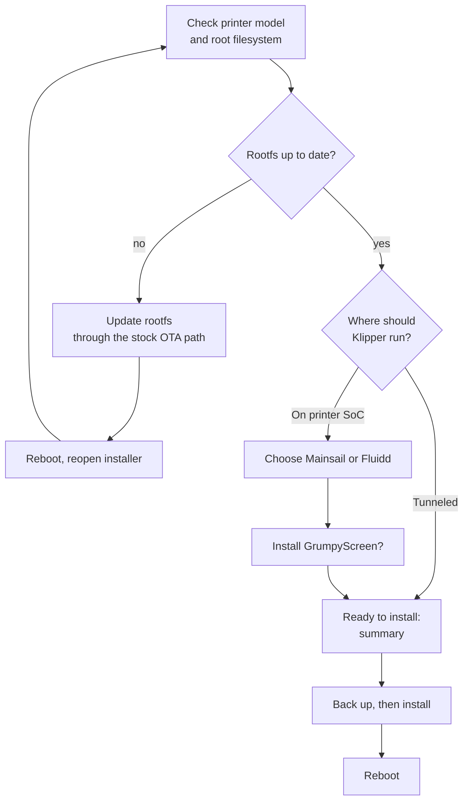

# OpenCreator Installer

In testing

The OpenCreator Installer is a touchscreen app that runs on the Creator 5's own
screen. It walks you through installing OpenCreator CFW from a USB drive: on the
printer itself, or tunneled to a Raspberry Pi / SBC. It backs everything up
first, so you can go back. Its source is the `opencreator-installer`
repository.

!!! warning "Not released yet"
    The installer flow has been tested in demo mode and the on-device install
    steps have been run, but it has not yet been tested end to end on a printer
    running the real touchscreen GUI. Do not run it on your printer until a
    release is announced on [Discord](https://discord.gg/RsdkqDtfww).

## What you need

- [ ] A Creator 5 or Creator 5 Pro
- [ ] A USB drive that meets the [requirements](installation-and-safety.md#requirements-for-usb)
- [ ] Internet on the printer (Klipper, Moonraker and the web UIs are downloaded during install)
- [ ] For tunnel mode: an SBC, see [OpenCreator for SBC](rpi-klipper.md)

## How it goes

1. **Checking.** The installer reads the printer model and checks the supplied
   root filesystem image against its SHA-256 checksum. If the printer already
   has that image, this step is skipped.
2. **Root filesystem update** (only when needed). The new image is written to
   the inactive slot through FlashForge's own OTA helper, so the kernel and
   the other partitions are not touched. The printer restarts after five
   seconds; open the installer again and it continues where it left off.
3. **Where should Klipper run?** *On printer SoC* installs everything on the
   printer. *Tunneled* turns the printer's board into a bridge for an SBC.
4. **Web interface** (SoC only): Mainsail or Fluidd.
5. **Touchscreen** install GrumpyScreen (recommended) or not.
6. **Ready to install** shows the printer, mode, web UI and touchscreen you
   chose. *Back up and install* starts; *Demo install* does a dry run (below).
7. **Installing** shows each step live with a progress bar and elapsed time.
8. **Installation complete**: reboot from the button, then unplug the USB drive.

## What gets installed

=== "On printer SoC"

    | Step | What happens |
    | --- | --- |
    | MCU firmware | Flashes all four boards (eBoard, heaterBoard, levelBoard, mainBoardGD) from the package on the USB drive, after checking its checksum. Skipped if the boards already run that firmware. |
    | Klipper | The OpenCreator Klipper port ([klipper-c5](https://github.com/FlashForge-C5-Modding-Group/klipper-c5)), latest version. |
    | Moonraker | Latest Moonraker. |
    | Config | The OpenCreator printer config and startup scripts from [opencreator-fs](https://github.com/FlashForge-C5-Modding-Group/opencreator-fs), including the [first-time setup dialog](printer-features.md#first-time-setup) and the OpenCreator Fluidd theme. |
    | Web UI | The latest Mainsail or Fluidd release. |
    | Touchscreen | The latest [GrumpyScreen](https://github.com/FlashForge-C5-Modding-Group/grumpyscreen) release, if chosen. |

=== "Tunneled"

    | Step | What happens |
    | --- | --- |
    | MCU firmware | Same as SoC mode. |
    | Bridge | Installs the tunnel bridge and switches the printer's board to bridge-only mode, so it forwards the four boards to your SBC over USB. |
    | Touchscreen | The latest [GrumpyScreen](https://github.com/FlashForge-C5-Modding-Group/grumpyscreen) release, if chosen. |
    | SBC | Not done by the installer: after rebooting the printer, run the SBC installer from [OpenCreator for SBC](rpi-klipper.md#on-the-sbc). |

## Safety features

-   :material-printer-3d-nozzle-alert: **Model check**

    ---

    Only a Creator 5 (PID 0028) or Creator 5 Pro (PID 0029) is accepted. If the
    model can't be detected, installing is blocked.

-   :material-backup-restore: **Backup first**

    ---

    Before anything changes, Klipper, Moonraker, the FlashForge program folder,
    your config and the web UI folders are archived to the USB drive.

-   :material-restore: **Restore**

    ---

    If a backup exists, the installer offers *Restore backup*, also right after
    a failed install. Folders that did not exist before are removed again. MCU
    firmware is not rolled back.

-   :material-alert-circle-check: **Preflight warnings**

    ---

    Warns when there is less than 256 MB free on the printer or the USB drive,
    or the backup folder is missing or read-only.

-   :material-text-box-search: **Log**

    ---

    The *Log* button shows everything the installer did. The same log is saved
    to the USB drive as `opencreator-installer.log`.

-   :material-flask: **Demo install**

    ---

    Runs every step for real, but writes into a separate folder instead of the
    system, so you can see exactly what would change without touching the
    printer.

When the install finishes, it records what was installed (installer version,
model, mode, web UI, touchscreen, backup location and time) in
`/usr/data/opencreator/install.json`. The next run shows that as the previous
install.

!!! danger "Power"
    Do not power off the printer while the root filesystem update or the MCU
    flashing is running. A power loss there can leave the printer needing
    firmware recovery.
