# OpenCreator Installer

The OpenCreator Installer is a touchscreen app that runs on the Creator 5's own
screen. It walks you through installing OpenCreator CFW from a USB drive: on the
printer itself, or tunneled to a Raspberry Pi / SBC. It backs everything up
first, so you can go back. Its source is the `opencreator-installer`
repository.

## Download

The installer is part of each [OpenCreator release](https://github.com/FlashForge-C5-Modding-Group/OpenCreator/releases/latest); use the latest one.
Extract the zip to the root of a FAT32 USB drive, then follow
[Steps to install OpenCreator](installation-and-safety.md#steps-to-install-opencreator).

## What you need

- [x] A Creator 5 or Creator 5 Pro on FlashForge firmware (1.9.9 recommended)
- [x] A USB drive that meets the [requirements](installation-and-safety.md#requirements-for-usb)
- [x] Internet on the printer (Entware, Kalico, Moonraker and the web UIs are downloaded during install)
- [x] For tunnel mode: an SBC, see [OpenCreator for SBC](rpi-klipper.md)
- [x] A printer that has at least 200MB on the prog partition and 1gb of storage on the data partition

## How it goes


1. **Checking.** The installer reads the printer model and FlashForge kernel
   package. The printer's root filesystem is not changed; everything is
   installed next to the stock software. The bottom of the screen shows the
   installer version, the MCU firmware on the drive (and what the boards last
   got, if OpenCreator flashed them before), the kernel package and the build
   date.

   [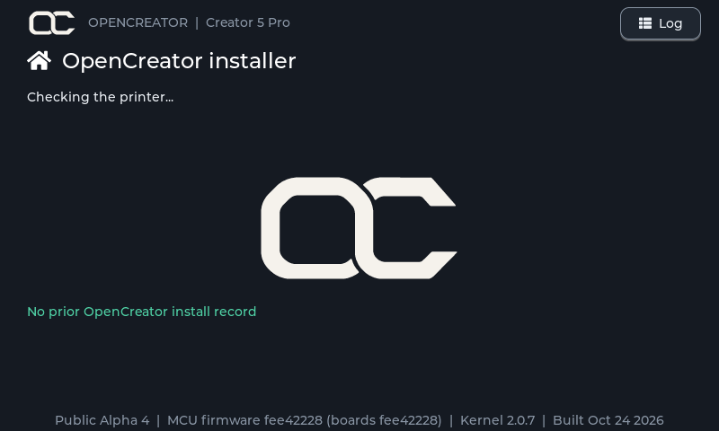{ .oc-shot loading=lazy }](assets/images/installer/check.png)
2. **Where should Klipper run?** *On printer SoC* installs everything on the
   printer. *Tunneled* turns the printer's board into a bridge for an SBC.
   Tunneled needs FlashForge firmware 1.9.9: on 1.9.8 or older it's greyed
   out, and the page asks you to update the printer to 1.9.9 first.
   Choosing *Tunneled* asks for the tunneled-mode password, typed on the screen's
   keyboard, both for a first install and for switching an installed printer to
   tunneled. It isn't asked again when the printer is already tunneled.

   [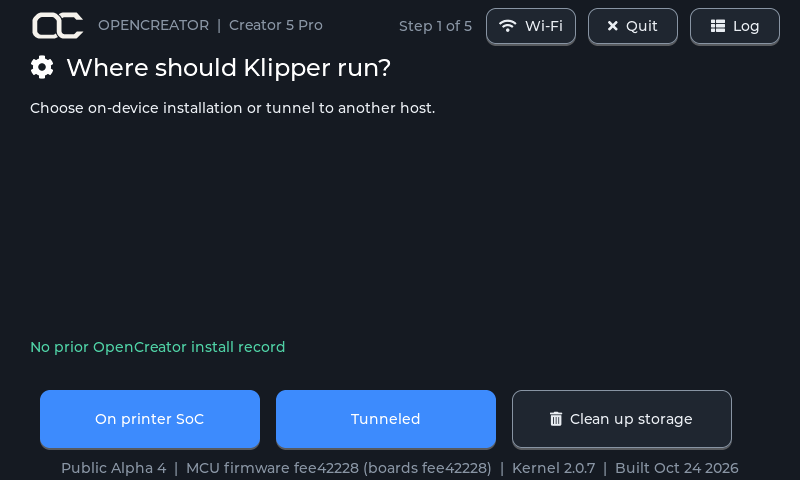{ .oc-shot loading=lazy }](assets/images/installer/mode.png)
3. **Web interface** (SoC only): Fluidd (recommended) or Mainsail. Both are installed; the
   one you pick is the one the printer's web page shows.

   [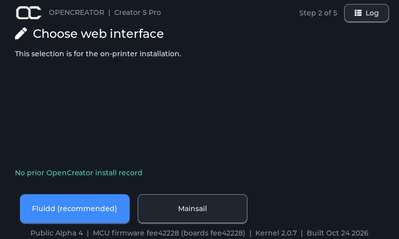{ .oc-shot loading=lazy }](assets/images/installer/web.png)
4. **Touchscreen**: install GrumpyScreen (recommended) or not.

   [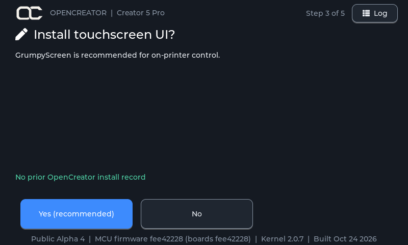{ .oc-shot loading=lazy }](assets/images/installer/touch.png)
5. **Ready to install** shows the printer, mode, web UI and touchscreen you
   chose. *Back up and install* starts; *Install without backup* skips the
   backup (faster when re-running); *Demo install* does a dry run (below).

   [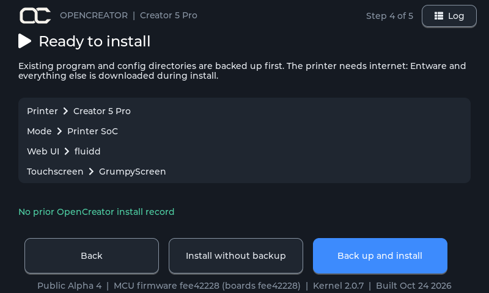{ .oc-shot loading=lazy }](assets/images/installer/ready.png)
6. **Installing** shows each step live with its number (*Step 3 of 11*), a
   progress bar and elapsed time.
   Installing Entware and the Python packages takes a while.

   [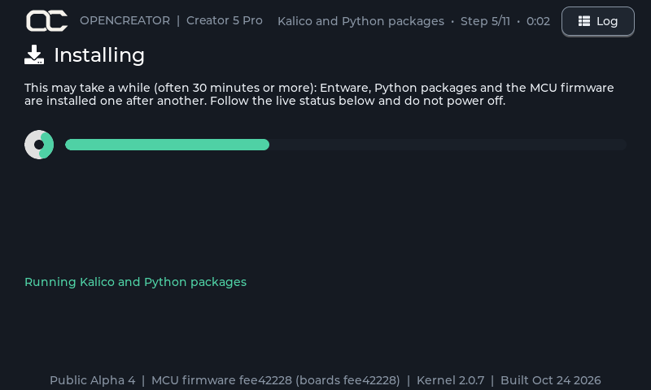{ .oc-shot loading=lazy }](assets/images/installer/installing.png)
7. **Installation complete**: reboot from the button, then unplug the USB drive.

   [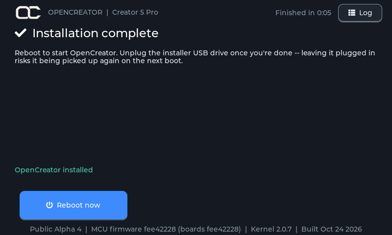{ .oc-shot loading=lazy }](assets/images/installer/done.png)

### Already installed

If the printer already has OpenCreator from the same installer version, the
installer opens on **OpenCreator is up to date**:

[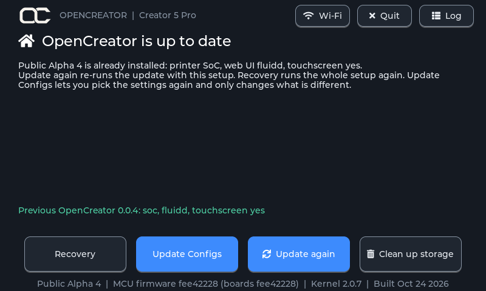{ .oc-shot loading=lazy }](assets/images/installer/installed.png)

- **Update again** re-runs the update with the current setup.
- **Recovery** runs the whole setup again, as above.
- **Update Configs** asks the same questions (where Klipper runs, web UI,
  touchscreen), then shows only what differs from the current setup and
  changes just that. For example, switching from *On printer SoC* to
  *Tunneled* only installs the bridge, and switching back only installs what
  SoC mode needs and isn't on the printer yet. Switching web UI changes which
  one the printer serves; turning the touchscreen off keeps GrumpyScreen on
  the printer but stops starting it. Nothing is backed up. Reboot afterwards.
- **Restore backup** and **Rollback to stock** show up when there's a backup or
  FlashForge's own firmwareExe to go back to.

### Update available

With an older OpenCreator installed, it opens on **Update available**, which
updates in place with the setup shown. Your configs and files are kept; OpenCreator
files you changed are saved to the backup. *Change setup* asks the questions again.

[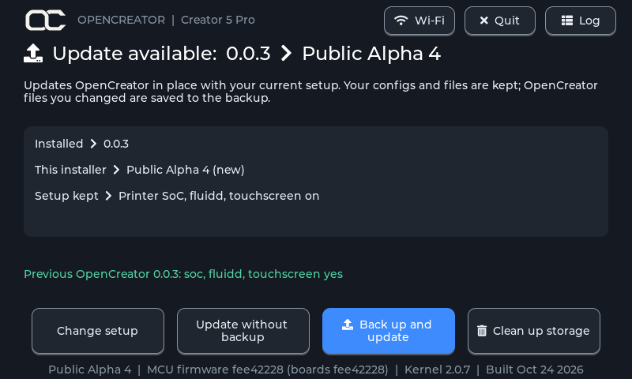{ .oc-shot loading=lazy }](assets/images/installer/update.png)

### No internet

Without internet, it lists the Wi-Fi networks it can see. Tap one and type its
password on the screen's keyboard. Quit starts the printer normally.

[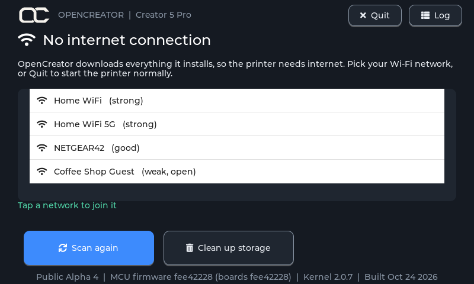{ .oc-shot loading=lazy }](assets/images/installer/offline.png)

### Clean up storage

Every start page (first install, update, already installed, no internet,
unsupported kernel) has **Clean up storage**. Its confirmation page warns that
nothing can be brought back, and *Yes, delete* only works after a 10-second
countdown. It deletes:

[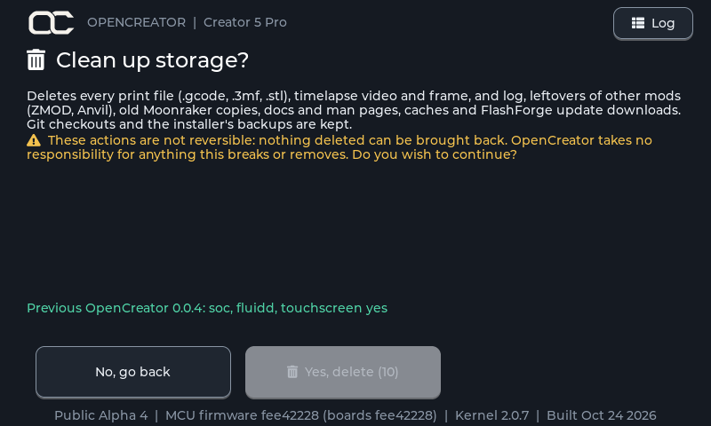{ .oc-shot loading=lazy }](assets/images/installer/cleanup.png)


- every print file (`.gcode`, `.3mf`, `.stl`), `.mp4` and log under `/usr/data`
  and `/usr/prog`;
- everything in `/usr/data/logs`, `/usr/data/update` (FlashForge update
  downloads), `/usr/data/opencreator/timelapse`,
  `/usr/data/opencreator/klipper/logs` and the Entware caches;
- other mods' leftovers (ZMOD, Anvil), old Moonraker copies, and the stock
  Klipper docs and man pages.

Git checkouts (Klipper, Moonraker, opencreator-fs and the rest), the stock
firmware's own model files and the installer's backups are kept. It can't be
undone, and OpenCreator takes no responsibility for anything it breaks or
removes. Based on [CleanFlashforgeCreator5Pro](https://github.com/d3dorsett/CleanFlashforgeCreator5Pro).

??? info "Supported kernel packages"
    Entware needs *legacy NaN*, which is switched on with one byte written at
    an address that depends on the FlashForge kernel package
    (`/usr/prog/PROGRAM/kernel/`): `0x00a130d1` for 2.0.1 to 2.0.6,
    `0x00B330D1` for 2.0.7 (FlashForge 1.9.9) and `0x00B030D1` for 2.0.8
    (FlashForge 2.0.0). On any other package the
    installer stops without changing anything.

## What gets installed

=== "On printer SoC"

    | Step | What happens |
    | --- | --- |
    | Entware | The Entware package manager in `/usr/data/bin/opt`, with git, gcc, Python and Moonraker's build dependencies. |
    | LoopScript | OpenCreator's startup system from [opencreator-fs](https://github.com/FlashForge-C5-Modding-Group/opencreator-fs): it replaces FlashForge's `firmwareExe` (a copy of the original is kept) and starts everything below at boot. It also replaces the boot logo with the OpenCreator one (the original is backed up). |
    | MCU firmware | Flashes all four boards (eBoard, heaterBoard, levelBoard, mainBoardGD) from the package on the USB drive, after checking its checksum. Skipped if the boards already run that firmware. |
    | Klipper | [Kalico](https://github.com/FlashForge-C5-Modding-Group/kalico) with the OpenCreator printer config, including the [first-time setup dialog](printer-features.md#first-time-setup) and the OpenCreator Fluidd theme, in `/usr/data/opencreator/klipper`. A first install takes the printer's input shaper and hotend and bed PID tuning from FlashForge's config; a config you already have there is kept. |
    | Moonraker | The latest Moonraker, replacing FlashForge's older one. Its update manager lists Kalico, Moonraker, Mainsail, Fluidd and **opencreator** (the OpenCreator configs). Updating *opencreator* merges the new config templates into yours within a minute, keeping your own edits. Restart Klipper afterwards to load them. |
    | Web UI | The latest Mainsail and Fluidd; the printer's web page shows the one you chose. |
    | Touchscreen | The latest [GrumpyScreen](https://github.com/FlashForge-C5-Modding-Group/grumpyscreen) release, if chosen. |
    | Root login | Adds the root login `opencreator` (password `FlashForge2026`) for SSH. See [Root login](#root-login). |

=== "Tunneled"

    | Step | What happens |
    | --- | --- |
    | Entware | The Entware package manager, with git, gcc and socat. |
    | LoopScript | Same as SoC mode; in tunnel mode it starts the bridge instead of Klipper. |
    | MCU firmware | Same as SoC mode. |
    | Bridge | Installs the socat bridge and switches the printer's board to bridge-only mode, so it forwards the four boards to your SBC over USB. |
    | Touchscreen | The latest [GrumpyScreen](https://github.com/FlashForge-C5-Modding-Group/grumpyscreen) release, if chosen. Point it at your SBC afterwards: set `host` under `[moonraker]` in `/usr/data/grumpyscreen/grumpyscreen.cfg`. |
    | Root login | Same as SoC mode. |
    | SBC | Not done by the installer: after rebooting the printer, run the SBC installer from [OpenCreator for SBC](rpi-klipper.md#on-the-sbc). |

## Root login

The installer adds a root login, so you can SSH into the printer:

| | |
| --- | --- |
| User | `opencreator` |
| Password | `FlashForge2026` |

```sh
ssh opencreator@<printer IP>
```

!!! warning "Change the password"
    Everyone who installs OpenCreator gets the same default password. To set
    your own, log in over SSH and run:

    ```sh
    passwd opencreator
    ```

    Type the new password twice. Running the installer again keeps the
    password you set.

## Safety features

<div class="grid cards" markdown>

-   :material-printer-3d-nozzle-alert: **Model check**

    ---

    Only a Creator 5 (PID 0028) or Creator 5 Pro (PID 0029) on a supported
    kernel package is accepted. Otherwise installing is blocked.

-   :material-backup-restore: **Backup first**

    ---

    Before anything changes, FlashForge's `firmwareExe`, Moonraker, the
    OpenCreator folder (Klipper and your config), the web UI folders and the
    nginx config are archived to the USB drive.

-   :material-restore: **Restore**

    ---

    If a backup exists, the installer offers *Restore backup*, also right after
    a failed install. Folders that did not exist before are removed again. MCU
    firmware is not rolled back, and Entware stays installed.

-   :material-alert-circle-check: **Preflight warnings**

    ---

    Warns when there is less than 256 MB free on the printer or the USB drive,
    or the backup folder is missing or read-only.

-   :material-text-box-search: **Log**

    ---

    The *Log* button shows everything the installer did. The same log is saved
    to the USB drive as `opencreator-installer.log`.

-   :material-flask: **Demo install**

    ---

    Runs every step for real, but writes into a separate folder instead of the
    system, so you can see exactly what would change without touching the
    printer.

</div>

When the install finishes, it records what was installed (installer version,
model, mode, web UI, touchscreen, backup location and time) in
`/usr/data/opencreator/install.json`. The next run shows that as the previous
install.

!!! danger "Power"
    Do not power off the printer while the installer is running, especially
    during MCU flashing. A power loss there can leave the printer needing
    firmware recovery.
