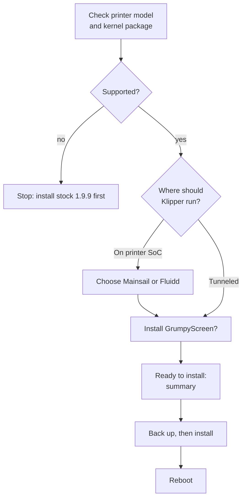

# OpenCreator Installer

In testing

The OpenCreator Installer is a touchscreen app that runs on the Creator 5's own
screen. It walks you through installing OpenCreator CFW from a USB drive: on the
printer itself, or tunneled to a Raspberry Pi / SBC. It backs everything up
first, so you can go back. Its source is the `opencreator-installer`
repository.

!!! warning "Not released yet"
    The installer flow has been tested in demo mode and the on-device install
    steps have been run, but it has not yet been tested end to end on a printer
    running the real touchscreen GUI. Do not run it on your printer until a
    release is announced on [Discord](https://discord.gg/RsdkqDtfww).

## What you need

- [ ] A Creator 5 or Creator 5 Pro on FlashForge firmware (1.9.9 recommended)
- [ ] A USB drive that meets the [requirements](installation-and-safety.md#requirements-for-usb)
- [ ] Internet on the printer (Entware, Kalico, Moonraker and the web UIs are downloaded during install)
- [ ] For tunnel mode: an SBC, see [OpenCreator for SBC](rpi-klipper.md)

## How it goes

1. **Checking.** The installer reads the printer model and FlashForge kernel
   package. The printer's root filesystem is not changed; everything is
   installed next to the stock software.
2. **Where should Klipper run?** *On printer SoC* installs everything on the
   printer. *Tunneled* turns the printer's board into a bridge for an SBC.
3. **Web interface** (SoC only): Mainsail or Fluidd. Both are installed; the
   one you pick is the one the printer's web page shows.
4. **Touchscreen**: install GrumpyScreen (recommended) or not.
5. **Ready to install** shows the printer, mode, web UI and touchscreen you
   chose. *Back up and install* starts; *Demo install* does a dry run (below).
6. **Installing** shows each step live with a progress bar and elapsed time.
   Installing Entware and the Python packages takes a while.
7. **Installation complete**: reboot from the button, then unplug the USB drive.

??? info "Supported kernel packages"
    Entware needs *legacy NaN*, which is switched on with one byte written at
    an address that depends on the FlashForge kernel package
    (`/usr/prog/PROGRAM/kernel/`): `0x00a130d1` for 2.0.1 to 2.0.6 and
    `0x00B330D1` for 2.0.7 (FlashForge 1.9.9). On any other package the
    installer stops without changing anything.

## What gets installed

=== "On printer SoC"

    | Step | What happens |
    | --- | --- |
    | Entware | The Entware package manager in `/usr/data/bin/opt`, with git, gcc, Python and Moonraker's build dependencies. |
    | LoopScript | OpenCreator's startup system from [opencreator-fs](https://github.com/FlashForge-C5-Modding-Group/opencreator-fs): it replaces FlashForge's `firmwareExe` (a copy of the original is kept) and starts everything below at boot. |
    | MCU firmware | Flashes all four boards (eBoard, heaterBoard, levelBoard, mainBoardGD) from the package on the USB drive, after checking its checksum. Skipped if the boards already run that firmware. |
    | Klipper | [Kalico](https://github.com/FlashForge-C5-Modding-Group/kalico) with the OpenCreator printer config, including the [first-time setup dialog](printer-features.md#first-time-setup) and the OpenCreator Fluidd theme, in `/usr/data/opencreator/klipper`. A config you already have there is kept. |
    | Moonraker | The latest Moonraker, replacing FlashForge's older one. |
    | Web UI | The latest Mainsail and Fluidd; the printer's web page shows the one you chose. |
    | Touchscreen | The latest [GrumpyScreen](https://github.com/FlashForge-C5-Modding-Group/grumpyscreen) release, if chosen. |

=== "Tunneled"

    | Step | What happens |
    | --- | --- |
    | Entware | The Entware package manager, with git, gcc and socat. |
    | LoopScript | Same as SoC mode; in tunnel mode it starts the bridge instead of Klipper. |
    | MCU firmware | Same as SoC mode. |
    | Bridge | Installs the socat bridge and switches the printer's board to bridge-only mode, so it forwards the four boards to your SBC over USB. |
    | Touchscreen | The latest [GrumpyScreen](https://github.com/FlashForge-C5-Modding-Group/grumpyscreen) release, if chosen. Point it at your SBC afterwards: set `host` under `[moonraker]` in `/usr/data/grumpyscreen/grumpyscreen.cfg`. |
    | SBC | Not done by the installer: after rebooting the printer, run the SBC installer from [OpenCreator for SBC](rpi-klipper.md#on-the-sbc). |

## Safety features

-   :material-printer-3d-nozzle-alert: **Model check**

    ---

    Only a Creator 5 (PID 0028) or Creator 5 Pro (PID 0029) on a supported
    kernel package is accepted. Otherwise installing is blocked.

-   :material-backup-restore: **Backup first**

    ---

    Before anything changes, the FlashForge program folder, Moonraker, the
    OpenCreator folder (Klipper and your config), the web UI folders and the
    nginx config are archived to the USB drive.

-   :material-restore: **Restore**

    ---

    If a backup exists, the installer offers *Restore backup*, also right after
    a failed install. Folders that did not exist before are removed again. MCU
    firmware is not rolled back, and Entware stays installed.

-   :material-alert-circle-check: **Preflight warnings**

    ---

    Warns when there is less than 256 MB free on the printer or the USB drive,
    or the backup folder is missing or read-only.

-   :material-text-box-search: **Log**

    ---

    The *Log* button shows everything the installer did. The same log is saved
    to the USB drive as `opencreator-installer.log`.

-   :material-flask: **Demo install**

    ---

    Runs every step for real, but writes into a separate folder instead of the
    system, so you can see exactly what would change without touching the
    printer.

When the install finishes, it records what was installed (installer version,
model, mode, web UI, touchscreen, backup location and time) in
`/usr/data/opencreator/install.json`. The next run shows that as the previous
install.

!!! danger "Power"
    Do not power off the printer while the installer is running, especially
    during MCU flashing. A power loss there can leave the printer needing
    firmware recovery.
