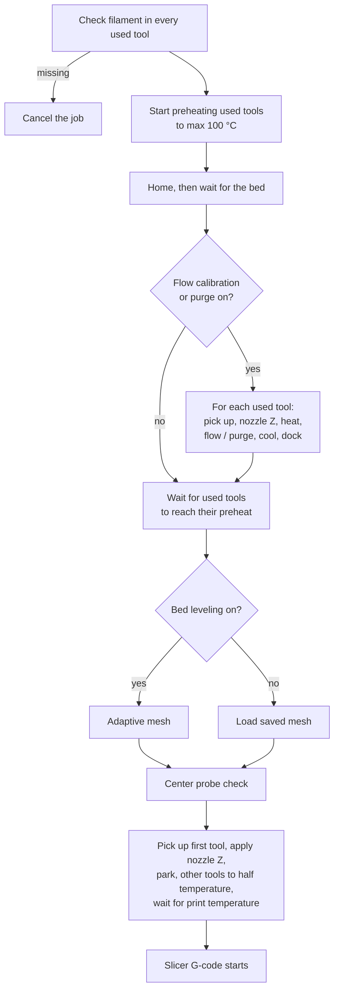

# Current print workflow

The `C5_PRINT_START` macro prepares only the tools the job uses. This page
describes the current config; not every printer and filament combination has
been tested.

The slicer or print dispatcher supplies `TOOL=0..3`, `HOTEND`, and `BED`.
`TOOLS=0,3`, for example, identifies all tools used by a multi-tool job;
`TOOL` must be in that list. `HOTEND0` through `HOTEND3` can override the
shared hotend temperature for individual tools. The macro checks the physical
filament-presence input for **each used tool**. A missing tool's filament
cancels the job; unused tools are not required to be loaded.

## Preparation order

1. Start a non-blocking preheat of every used tool to at most 100 °C, so the
   tools warm while the printer homes and the bed heats.
2. Home for printing. If a tool is attached, the Creator 5 homing helper
   handles its docking before Z homing. Then wait for the bed to reach its
   target.
3. If flow calibration or purge is enabled, prepare each used tool in turn:
   select it, establish its nozzle Z reference, heat it to its material
   temperature, run the selected flow and/or purge operation, cool it for
   docking, and release it.
4. Wait for every used tool to reach its preheat (re-applied, since docking
   after priming may have left it cooler). Then clear the old mesh. When bed leveling is enabled, create an adaptive mesh.
   Otherwise, load the saved default mesh if one exists.
5. Probe the bed center as a check, then select the job's initial tool. Apply
   its automatic nozzle Z, verify that a safe nozzle Z is available, smart
   park, and wait for its print temperature. The print's other tools are set
   to their slicer idle temperature (Orca's *Idle temperature*), or 100 °C
   if it has none. The print's other tools are set
   to half their print temperature. The slicer's print moves follow.

The center probe check does **not** itself replace the automatic nozzle Z
measurement. A missing safe nozzle Z is a print-stopping condition, not a
reason to continue at zero offset.

Flow calibration, purge, and bed leveling can be toggled in the printer's
Misc controls or overridden for a job with `FLOW_CALIBRATION=0|1`,
`PURGE=0|1`, and `BED_LEVELING=0|1`. Turning off flow and purge removes those
preparation operations; it does not bypass the filament-presence or nozzle-Z
safety checks. See [Printer features](printer-features.md) for how the flow
measurement works.

At a normal job end, `C5_PRINT_STOP` handles tool parking and heater shutdown.
The optional lower-bed-at-end setting is separate from print-start bed
leveling. The printer configuration also routes cancellation through the stop
sequence, but a shutdown can prevent ordinary G-code cleanup. Confirm the
machine state before resuming after an MCU fault.
