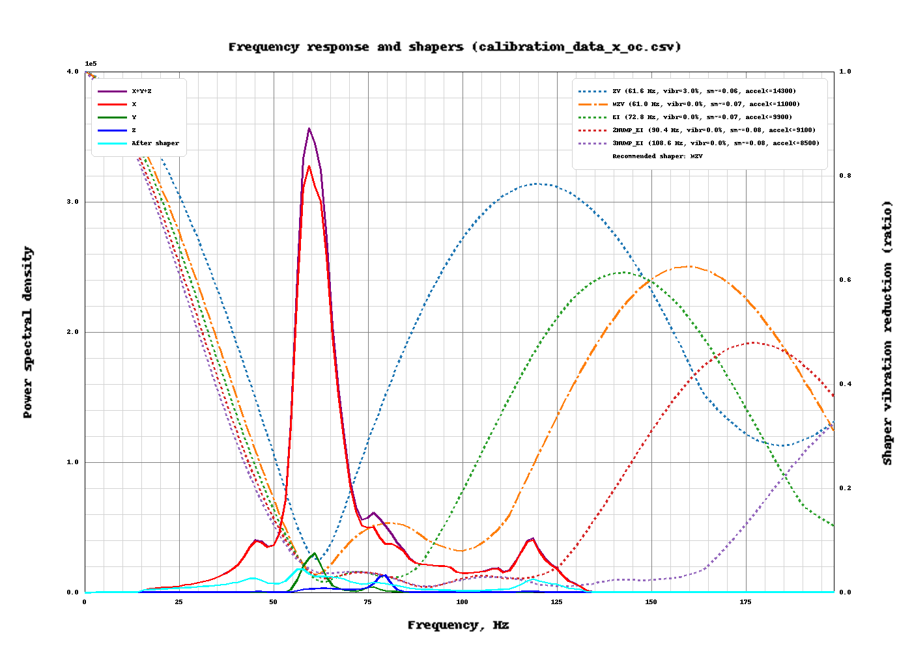

# Printer Features

## First-time setup

The first time you open Fluidd (or Mainsail, or look at the touchscreen) after
installing OpenCreator, a dialog welcomes you and asks two questions:

- **Clog Detection:** pause the print when a tool's filament wheel stops
  turning while filament is still loaded in it. Off by default.
- **Bed heat soak:** before a fresh bed mesh, wait a few minutes at bed
  temperature so the plate finishes warping first. Off by default.

There's nothing to calibrate first: a first install on the printer (SoC) takes
your printer's own calibration from FlashForge's config (`/usr/data/config/printer.cfg`), so it
starts with the input shaper and the PID tuning of all four hotends and the bed
that FlashForge measured. The bed mesh isn't taken; OpenCreator measures its
own. A reinstall or update keeps the config you already have. Tunneled
installs start with the template's values, so calibrate those yourself.

To calibrate yourself anyway: `CALIBRATE_INPUT_SHAPER` (or
[`CALIBRATE_INPUT_SHAPER_GRAPH`](#input-shaper-graphs) for graphs too),
`VFA_COMPENSATION`, and `C5_PID_CALIBRATE TOOL=1 TARGET=250` for a heater (add
`TOLERANCE=0.1` if a noisy heater won't settle; the default is 0.05).

The next page explains when to run the two other calibrations:
`C5_CALIBRATE_OFFSETS` if the tools' offsets weren't right on the stock
firmware either, and `C5_CALIBRATE_TOOL_POSITION` if a tool doesn't dock or
pick up cleanly. 

[{ .oc-side-shot loading=lazy }](assets/images/fluidd-macros-switches.png)

Fluidd also starts with the OpenCreator macro layout: the macros grouped into
*On / Off*, *Calibrations*, *Toolhead* and *Misc*. A layout you already set up
in Fluidd is kept.

If you close the dialog before finishing, it comes back within a minute. Once
you reach the last page it won't appear again. Both choices are ordinary
switches under Fans & Outputs, so you can change them at any time. To go
through the dialog again, send `C5_FIRST_SETUP` in the console.

## Timelapse

The OpenCreator Installer sets up
[Moonraker Timelapse](https://github.com/mainsail-crew/moonraker-timelapse). It
takes a camera frame at every layer change and renders them into an MP4 when the
print finishes. The videos show up under **Timelapse** in Fluidd and Mainsail,
where you can also change its settings (frame rate, parking the toolhead for
each frame, and so on).

To record a print, add `TIMELAPSE_TAKE_FRAME` to the slicer's layer change
G-code (see [Slicer Configuration](slicer-config.md#machine-g-code)). Without it,
only *hyperlapse* mode records, which takes frames at a fixed interval instead.

| | Printer (SoC) | Raspberry Pi (tunnel) |
|---|---|---|
| Camera | The printer camera, through its snapshot URL | The webcam you set up in Fluidd or Mainsail |
| ffmpeg | FlashForge's own build, already on the printer | Installed from apt |
| Frames | `/usr/data/opencreator/timelapse/frames/` | `/tmp/timelapse/` |
| Videos | `/usr/data/opencreator/timelapse/` | `~/printer_data/timelapse/` |

!!! note "Rendering on the printer"
    On the printer, ffmpeg runs at the lowest priority so it never holds up
    Klipper, which makes rendering slow: expect a few minutes for a long print.
    Frames are kept on storage rather than in `/tmp`, which is RAM and too
    small for a long print.

Moonraker's update manager keeps Timelapse current, as the `timelapse` entry.

## Input shaper graphs

`CALIBRATE_INPUT_SHAPER_GRAPH` does the same as `CALIBRATE_INPUT_SHAPER`
(measures both axes, applies the recommended shaper and saves it; add `SAVE=0`
to save later), and also draws a graph of each axis on the printer, the same
graph Klipper's `calibrate_shaper.py` makes on a PC. It is under
**Calibrations** on Fluidd's Macros card (Uncategorized on installs whose
macro layout is older than the macro).

The graphs are saved to the config folder as `input_shaper/shaper_x.png` and
`input_shaper/shaper_y.png`; open them from the config files in Fluidd or
Mainsail.

[{ .oc-shot loading=lazy }](assets/images/shaper-graph-example.png)

- **Left axis:** the measured vibrations (X, Y, Z and their sum) at each
  frequency. Peaks are resonances; *After shaper* is what the recommended
  shaper leaves of them.
- **Right axis:** how much each shaper lets through at each frequency. The
  recommended shaper is dash-dotted; the legend gives each one's frequency,
  remaining vibrations, smoothing and the highest acceleration it suits.

The figures come from Kalico's own shaper code, so they match what
`SHAPER_CALIBRATE` reports in the console. 

## Flow Calibration in the Creator 5 factory firmware

The touchscreen calls this **Flow Calibration**, but the routine is intended
to test **pressure advance**. It does not measure a printed line's width, weigh
extruded plastic, or calculate an extrusion multiplier. The host tries several
pressure-advance values while the eboard observes the extruder motor driver's
`SG_RESULT` load signal. The eboard reports whether each sampled waveform
passes its check.

The sequence below is reconstructed from the factory `firmwareExe.i64`
database, principally `BuildPage::clearNozzlePrint` and
`CommMgr::paTestMgr`, and from the factory `eBoard.hex`. 

### The stock test, step by step

1. The host resets the extruder position with `G92 E0`, switches to relative
   extrusion with `M83`, sets acceleration to 5000 mm/s² and square-corner
   velocity to 9 mm/s, enables the X/Y motor-driver control pins, and waits
   for queued motion to finish.
2. It tries these pressure-advance candidates in this order: `0.0100`,
   `0.0200`, `0.0150`, `0.0350`, `0.0250`, `0.0300`, and `0.0400`. For each
   candidate it sends `PA_ACTION ACTION=11 PC=666` to arm the eboard
   measurement, then `SET_PRESSURE_ADVANCE ADVANCE=<candidate>`.
3. The carriage starts each candidate at X40 and a Y position from 50 to 80 
   in 5 mm steps. It extrudes across six X strokes ending at X60, X100, X120,
   X140, X180, and X200. The X and Y movements don't actually happen and get discarded, this is mostly to trick 
   Klippy into thinking PA can be used. The short strokes extrude 1.13573 mm of filament at
   `F1080` (18 mm/s); the long strokes extrude 2.27146 mm at `F10980`
   (183 mm/s). Alternating slow and fast motion creates the motor-load
   transient that the eboard examines. 
4. The host sends `PA_ACTION ACTION=0 PC=666`, waits with `M400`, and reads
   `PA_GET`. It treats a returned value of `9` as a pass for that candidate.

The eboard firmware's `pa_action` handler resets its result and sample area
when action `11` starts a measurement, switches its acquisition mode, then
finalizes the capture when action `0` arrives. `get_emcu_pa_value` reports the
result back to the host as `pa_value value=<number>`. `9` means "pass"; it
isn't the measured pressure advance. How the eboard decides is described
[below](#how-the-eboard-judges-a-stroke). The host always sends `PC=666`, and
what that value means isn't known yet.

### Where the waveform comes from

The host does not synthesize an electrical waveform. It commands a sequence
of extruder moves. Changing extrusion speed changes the motor's mechanical
load; the TMC2209 turns that load into successive `SG_RESULT` register values.
The eboard reads those values over UART and stores valid replies in time
order. Plotting sample index against `SG_RESULT` produces the waveform that
the classifier examines. Consecutive samples are roughly 2 ms apart when no
reply is lost; dropped replies make sample index an imperfect time axis. It is
a driver load estimate, **not a direct motor current measurement** or a
measurement of deposited plastic.

In the current OpenCreator/Kalico bucket test, the carriage stays at the purge
bucket while E alone runs through six relative extrusion moves:

| Segment | Filament commanded | Default E speed | Nominal time at speed |
| --- | ---: | ---: | ---: |
| Slow | 1.13573 mm | 4.5 mm/s | 252 ms |
| Fast | 2.27146 mm | 22.875 mm/s | 99 ms |
| Slow | 1.13573 mm | 4.5 mm/s | 252 ms |
| Slow | 1.13573 mm | 4.5 mm/s | 252 ms |
| Fast | 2.27146 mm | 22.875 mm/s | 99 ms |
| Slow | 1.13573 mm | 4.5 mm/s | 252 ms |

Those durations are distance divided by speed, not exact captured pulse
widths: acceleration, motion planning, and transitions between moves alter
the actual timing. The test commands 9.08584 mm of filament per candidate.
`PA_ACTION ACTION=11` starts sampling before the moves; `M400` drains them,
and `PA_ACTION ACTION=0` closes the capture. The eboard polls the driver about
every 2 ms, accepts only complete replies with a valid CRC, and reserves 2,000
sample slots (about four seconds). Missing or invalid replies are not valid
load observations.

**Current limitation:** Kalico's extruder planner applies pressure advance
only when an extrusion move also has X or Y travel. These bucket strokes are
E-only, so changing `SET_PRESSURE_ADVANCE` between candidates does not itself
reshape their E motion. A pass currently shows that the driver-load waveform
matches the eboard's stroke criteria; it does **not** prove that the selected
pressure-advance value is optimal. The factory routine issues XY/E strokes,
whereas the current bucket-safe port intentionally omits XY movement. The
stock firmware's full waveform and its PA discrimination have not been
established by this Kalico implementation alone.

### How the eboard judges a stroke

This is how OpenCreator's own eboard firmware (in Kalico, `src/c5_eboard_pa.c`)
does it.

**Sampling.** While a measurement runs, the eboard asks the extruder's TMC2209
driver for its load reading (`SG_RESULT`) about every 2 ms, roughly 500 times
a second. The response parser checks its framing and CRC before storing a
reading.

**Judging.** In those readings the eboard looks for a stroke:

1. **Start:** the reading climbs by more than 99 without dropping.
2. **End:** the reading stays at 70 or below for 0.4 s (or the readings run out).
3. **Plateau:** the part above 150, minus 60 ms at each end.

The stroke passes when all of these are true:

- The plateau averages more than 150.
- The plateau lasts about 160–300 ms, roughly one slow stroke.
- Early in the stroke the reading jumps more than 20% above the plateau,
  for at least 3 readings.
- At the end it drops cleanly, from between half and all of the plateau
  level down to near zero.

If any stroke passes, the eboard answers `9`.

### What can make it fail

- **Klipper talking to the same driver.** Klipper checks the extruder driver
  about once a second over the same wire, which garbles the eboard's readings
  and stops the test from ever passing. OpenCreator's flow test now pauses
  those checks while it runs.
- **No X/Y motion.** Klipper only applies pressure advance to moves that
  include X or Y motion, so extruding in place tests nothing. Like the stock
  firmware, OpenCreator runs the stock X/Y strokes, but with the X/Y motors
  held still: they stay powered and locked, they just aren't sent any steps.
  The nozzle stays over the bucket, and afterwards the printer knows exactly
  where it is again, so no re-homing is needed.
- **Driver mode.** The TMC2209 only gives a useful `SG_RESULT` in its quiet
  StealthChop mode, so OpenCreator runs the extruder driver in StealthChop
  (`stealthchop_threshold: 999999` on `[tmc2209 extruder]` to
  `[tmc2209 extruder3]`). Klipper's default would be SpreadCycle. On stock
  firmware the eboard sets up the driver itself, so the stock config has no
  driver settings to compare with.

To see the driver settings the stock eboard uses, run
`DUMP_TMC STEPPER=extruder` in the console of a printer still on stock
firmware.

### How it chooses and applies a result

One pass tests up to seven candidates and keeps the **smallest** candidate
for which the eboard returned `9`. The host allows up to five passes, stopping
once three passes produce a valid candidate. It averages those three selected
values to produce that tool's result. If fewer than three passes succeed, the
test reports failure rather than producing a new value. The routine also
cleans up its motor-driver test mode after completion or interruption.

After preparing the tools, the print-start code sends `SET_PA_ADVANCE` with
the successful T0–T3 results and `ENABLE=1`. Entries without a result are
filled with `99.0` as placeholders. If flow testing is off, or no valid tool
result is available, it sends `SET_PA_ADVANCE T0=99.0 T1=99.0 T2=99.0
T3=99.0 ENABLE=0`. These final per-tool settings are distinct from the
temporary `SET_PRESSURE_ADVANCE` candidate applied during each test.

## Host pressure-advance test (OpenCreator, experimental)

`C5_FLOW_STROKES METHOD=host` is OpenCreator's own pressure-advance test. The
stock test only says whether each fixed candidate passes or fails. This one
has Klippy look at every driver reading itself and work out the pressure
advance, so it isn't limited to the stock candidates. It takes about a minute
per tool, where the stock test takes about two and a half.

It needs OpenCreator's eboard firmware with the reading stream (flashed by
installer 0.4.8 and later), and StealthChop on the extruder drivers, the same
as the stock test.

At print start it runs when the **host_pressure_advance** switch is on (Fans &
Outputs, `C5_MISC_HOST_PRESSURE_ADVANCE_ON`/`_OFF`, or `HOST_PRESSURE_ADVANCE=1`
on `C5_PRINT_START`), with `APPLY=1`. It is off by default and separate from
the stock **flow_calibration** switch. With both on, the stock test runs first
and the host test after it; if the host result is rejected, the stock value
stays.

### The idea

Pressure advance models nozzle pressure as trailing the extruder motor. The
right advance is the one that cancels that lag: by the time the motor reaches
a steady speed, pressure has already caught up.

So the test runs the extruder fast at a constant speed and watches the motor's
load (`SG_RESULT`) during that steady part:

- **Too little advance:** pressure is still building, so the load keeps
  rising.
- **Too much advance:** the extra push overshoots, so the load falls back.
- **Right advance:** the load stays flat.

Because the motor speed isn't changing during that part, a change in load can
only come from the melt pressure. The test measures this drift at a few
advance values and finds where it crosses zero.

### Readings

The stock eboard firmware only keeps its readings to make its own pass/fail
decision. OpenCreator's eboard firmware also keeps each reading with the
eboard's clock time, and Klippy downloads them afterwards (`get_pa_stream`).
That's about 500 readings a second, up to 6,000 (12 s) per run. Each one is
matched to the extruder's commanded position and speed at that moment.

Without that firmware, `SENSOR=sg` has Klippy poll the driver itself instead,
which gives far fewer readings.

### The strokes

Each run starts with 0.4 s at 1 mm/s of filament, then six strokes. Each
stroke is 0.5 s at 10.4 mm/s, then 0.4 s back at 1 mm/s. As in the stock test,
the X/Y motors are held still, and each move has X/Y travel four times its
extrusion so Klipper applies pressure advance to it. The first stroke is only a
warm-up and isn't scored.

### Scoring a stroke

Every stroke is measured from the moment it reaches speed:

- **Early:** 0.03–0.09 s in, just after the advance's own push has finished.
- **Late:** the rest of the stroke, up to 0.02 s before it ends.

The stroke's drift is (early − late) / late.

The motor's load reading also ripples with each electrical cycle of the
motor: once every four full steps, which is 0.0589 mm of filament on these
extruders. That ripple was more than half of the reading noise during a
stroke. The test fits it across all of a run's strokes (four harmonics) and
removes it before it compares early and late.

### Finding the answer

1. The test runs at advances of 0, 0.05 and 0.10, which gives 15 scored
   strokes.
2. It fits a straight line through (advance, drift) and takes the advance
   where the line crosses zero. A stroke whose reading drops to 0 or near it
   stalled the motor and isn't used.
3. Now and then a stroke reads far off. Up to a tenth of the strokes that sit
   more than four robust standard deviations off the line are dropped, and
   the line is fitted again.
4. If the load barely responds (\|t\| below 4), the test runs the same
   advances again, up to 24 runs in all. PLA needs this: its pressure
   settles within about 20 ms, so each stroke shows only a small drift.
5. The fit gives a 95% range for the answer. If that range is wider than
   0.03, the test runs twice more, at the answer ±0.01. It repeats this until
   the range is narrow enough, or until it has used six runs on this, the
   same as a normal nine-run test.

The answer is rejected, and nothing is changed, when:

| Reason | Meaning |
| --- | --- |
| Load does not respond | The drift barely changes with advance (\|t\| below 4). Usually the driver isn't in StealthChop. |
| Drifts the wrong way | Drift rises with advance, the opposite of what pressure does. |
| Outside the tested range | The answer is more than 0.02 outside the advances that were tested. |
| Too uncertain | The 95% range is still wider than 0.03 after nine runs. |

The trace is written to `/tmp/c5_flow_T<tool>.csv` (one row per reading:
run, advance, time, filament position, reading, commanded speed and
acceleration). The console shows each stroke's drift and the result, for
example:

```
T2 host flow test: pressure advance 0.0751 (95%: 0.0633-0.0869, t=-6.3, 25 strokes, 5 runs)
```

### Parameters

| Parameter | Default | |
| --- | --- | --- |
| `APPLY` | `0` | `1` sets the result as the tool's pressure advance if it isn't rejected |
| `ADVANCES` | `0,0.05,0.10` | Advances for the first runs, comma separated |
| `REFINE` | `1` | `0` skips the extra runs |
| `MAX_RUNS` | `9` | Limit on runs, including the extra ones |
| `WEAK_RUNS` | `24` | Limit on runs when the load barely responds; `0` turns the repeats off |
| `CURRENT` | `1` | Experimental: extruder run current during the strokes, as a fraction of the configured one. Lower makes pressure show up more, but noise grows as fast. Below about 0.8 the advance's push stalls the motor: on PETG this left too few strokes at PA 0.10 and gave 0.058 instead of about 0.075. |
| `SENSOR` | `eboard` | `eboard`: the eboard's reading stream; `sg`: Klippy polls the driver (used when the eboard firmware has no stream) |
| `FAST` | `10.4` | Stroke speed, mm/s of filament |
| `SLOW` | `1` | Speed between strokes, mm/s of filament |
| `STROKES` | `6` | Strokes per run |
| `FAST_TIME` | `0.5` | Stroke length, s |
| `SLOW_TIME` | `0.4` | Time between strokes, s |
| `LEAD` | `0.4` | Slow time before the first stroke, s |
| `RATIO` | `0.25` | Filament per mm of the (held) X/Y travel |

The tool must be attached and at printing temperature, with Z calibrated, as
for the stock test.

### Results so far

On T2 with PETG at 255 °C, five runs gave 0.067, 0.068, 0.074, 0.075 and 0.079
(one of these was rejected as too uncertain, before the extra runs were
added). The others took under a minute each. The stock test gives 0.028–0.030
for the same filament.

The stock test is limited by the motion more than by the filament. Its end
check fails above about 0.037 because the retract outruns the stroke's own
speed, and its spike check needs at least about 0.02. That leaves about 0.03
for most filaments.

Neither number has been checked against a print yet, so leave `APPLY` at 0
until it has. To check, print a pressure-advance tower with the same filament:

```
TUNING_TOWER COMMAND=SET_PRESSURE_ADVANCE PARAMETER=ADVANCE START=0 FACTOR=.005
```

Then compare the height where the corners look best with both results.

## Filament dryer (VDS)

On the SoC install, OpenCreator drives FlashForge's two-chamber VDS filament dryer the same way the stock
firmware does: over the printer's internal serial port `/dev/ttyS3` at 115200 baud. Plug the dryer in where
FlashForge says to before installing: the installer only turns the dryer controls on when a dryer answers.
It then writes `printer.accessory.dryer.cfg`, which loads `printer.dryer.cfg`. If you add a dryer later, rerun the
installer or add `[include printer.dryer.cfg]` to `printer.cfg` yourself.

| Command | What it does |
| --- | --- |
| `C5_DRYER_START CHAMBER=A\|B\|AB TEMP=45-85 HOURS=1-48` | Dry one or both chambers (`MINUTES=60-2880` works instead of `HOURS`) |
| `C5_DRYER_STOP CHAMBER=A\|B\|AB` | Stop drying |
| `C5_DRYER_PAUSE CHAMBER=A\|B\|AB` | Turn the heaters off; start again with `C5_DRYER_START` |
| `C5_DRYER_DEHUMIDIFY CHAMBER=A\|B\|AB ENABLE=0\|1` | Keep a chamber dry after drying |
| `C5_DRYER_STATUS` | Firmware version, and each chamber's state, temperature, humidity and time left |
| `C5_DRYER_PLA`, `C5_DRYER_PETG`, `C5_DRYER_ABS`, `C5_DRYER_OFF` | Presets (50, 65 and 80 °C for 6 hours) and stop; add `CHAMBER=A` or `B` for one chamber |

`CHAMBER` defaults to both. The chambers also show up as the temperature sensors **dryer_a** and **dryer_b**,
with their humidity, so Fluidd and Mainsail graph them. Macros can read `printer.creator5_dryer`
(`connected`, `firmware_version`, and per chamber `drying`, `temperature`, `humidity`, `remaining_minutes`).

The dryer's own firmware limits drying to 45-85 °C and 1-48 hours. OpenCreator doesn't update the dryer's
firmware; if `C5_DRYER_STATUS` says it is in its bootloader, update it from stock FlashForge firmware.

## Offset Calibration

Offset calibration aligns the *nozzles* of T0–T3 for printing. It is separate
from locating their docks. The Creator 5 port exposes it through
`C5_CALIBRATE_OFFSETS`; measurements and the levelboard reference are kept in
`/usr/data/firmwareRes/config/extruder.json`.

Calibration cannot run during a print. If a tool is
attached, the carriage first raises it to the safe Z clearance and docks it.
The ordinary calibration pin is then probed at two known locations. Their
contact-height difference is used to reject a plate that may still be
installed and to set a safe approach floor for the following measurements.

With the carriage bare, the routine contacts the levelboard fixture to
establish its Z reference, then scans outward from its center for the X+,
Y+, X-, and Y- edges. Each edge scan is limited to 7 mm; opposite edges
give the fixture's X/Y center. The routine then picks up T0, probes its Z
against the fixture, scans its four X/Y edges, raises clear of the fixture,
and docks it. It repeats that sequence for T1, T2, and T3. The saved X/Y
printing offsets are each tool's measured center relative to T0. Its nozzle
Z offset uses the tool's measured Z relative to the fixture reference, plus
the separate per-tool Z fine adjustment. The code rejects measurements beyond
its configured correction limits or an unsafe resulting nozzle Z offset.

**CFW**

The all-tool run saves only after all four tools succeed. It makes a backup
of `extruder.json` and replaces that file atomically, so a failed tool does
not leave a partially saved set. The measured offsets are also applied to
the active tool through Klipper's G-code offset when it is selected.

A single tool can be recalibrated with `TOOL=0` through `TOOL=3`. It still
requires removing and checking the build plate; it docks any attached tool,
checks the ordinary pin, and automatically picks up the requested tool.
`LEVELBOARD=0` skips refreshing the *bare fixture reference* for a single
tool, but does not skip that tool's levelboard measurement. `Z=0` performs
XY-only calibration and needs a configured scan height or `SCAN_Z`; the
default `Z=1` probes the nozzle Z automatically. `TOOL=ALL` always refreshes
the fixture reference and requires `Z=1`.

## Baby stepping

Baby stepping a tool's Z offset during a print, from Fluidd's or Mainsail's
Z adjust buttons or `SET_GCODE_OFFSET Z_ADJUST=`, is saved as you go. It's
saved as that tool's Z adjustment in `/usr/data/firmwareRes/config/zoffset.json`,
the same value the touchscreen's Z offset sets. The next print, and the same
tool after a toolchange, start from it. Each tool keeps its own value.

| Macro | What it does |
| --- | --- |
| `LIST_BABYSTEP` | Shows the saved Z adjustment for every tool. `TOOL=2` shows only T2. |
| `CLEAR_BABYSTEP TOOL=1` | Resets T1's saved Z adjustment to 0. With no `TOOL`, or `TOOL=ALL`, it resets all four. |

Clearing the attached tool also takes the adjustment off its current Z offset.
Because the touchscreen uses the same value, clearing a tool also clears its
touchscreen Z offset.

A Z change of more than 1 mm at once isn't treated as baby stepping and isn't
saved. To stop saving baby stepping, add `persist_babystep: False` to
`[creator5_toolchanger]`.

## Toolhead Dock Calibration

Toolhead dock calibration, called **Extruder Position Calibrate** in the
factory UI, finds the physical pickup/docking X/Y coordinates for one tool.
It does **not** change the nozzle offsets used to align layers during a
print. In the Creator 5 port, run `C5_CALIBRATE_TOOL_POSITION T=0` through
`T=3`, or use the underlying `EXTRUDER_POSITION_CALIBRATE T=n` command.

Before starting, park all four tools, home the printer, raise Z to at least
the configured safe clearance (10 mm in the supplied config), and let every
toolhead cool below 50 °C. A print must not be active. The build plate does
not need to be removed for this calibration.

1. The routine disables X/Y motors and asks you to move the bare master
   carriage by hand to the chosen parked tool. It waits for both that dock's
   holder sensor and its grab sensor to register contact.
2. Once contact is detected, it asks you to release the carriage and waits
   briefly before taking over. It latches the tool and pulls it clear,
   checking that the holder sensor released while the grab sensor remains
   active.
3. It measures X and Y against the printer's X/Y home references, calculates
   the dock coordinates, and rejects a correction beyond the configured
   limit (2 mm in the supplied config).
4. It rehomes X/Y, redocks the tool using the measured coordinates, and only
   then saves them as `x_check_pos`/`y_check_pos` for T0, or the corresponding
   numbered keys for T1–T3, in `extruder.json`. A timestamped backup is made
   first.

If contact, sensor verification, measurement, or redocking fails, the
routine does not save new dock coordinates. 
