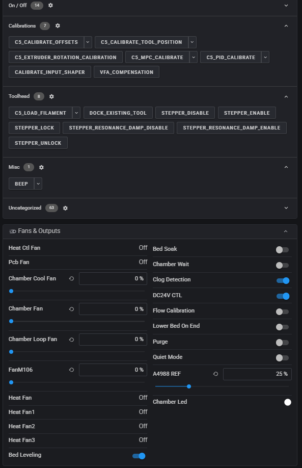

# Printer Features

## First-time setup

The first time you open Fluidd (or Mainsail, or look at the touchscreen) after
installing OpenCreator, a dialog welcomes you and asks two questions:

- **Clog Detection:** pause the print when a tool's filament wheel stops
  turning while filament is still loaded in it. Off by default.
- **Bed heat soak:** before a fresh bed mesh, wait a few minutes at bed
  temperature so the plate finishes warping first. Off by default.

Then it calibrates, since OpenCreator doesn't use FlashForge's calibration.
The **Calibrate** page has a button for each, and shows which ones are done:

- **PID tuning** (`C5_PID_CALIBRATE`, all four tools)
- **Input shaper** (`CALIBRATE_INPUT_SHAPER`)
- **VFA** (`VFA_COMPENSATION`)

The dialog closes while a calibration runs and comes back when it's finished.
*Save and continue* saves all the results at once (`SAVE_CONFIG`), Klipper
restarts and the dialog picks up where it left off. *Skip* moves on without
calibrating.

The next page explains when to run the two other calibrations:
`C5_CALIBRATE_OFFSETS` if the tools' offsets weren't right on the stock
firmware either, and `C5_CALIBRATE_TOOL_POSITION` if a tool doesn't dock or
pick up cleanly. 

[{ .oc-side-shot loading=lazy }](assets/images/fluidd-macros-switches.png)

Fluidd also starts with the OpenCreator macro layout: the macros grouped into
*On / Off*, *Calibrations*, *Toolhead* and *Misc*. A layout you already set up
in Fluidd is kept.

If you close the dialog before finishing, it comes back within a minute. Once
you reach the last page it won't appear again. Both choices are ordinary
switches under Fans & Outputs, so you can change them at any time. To go
through the dialog again, send `C5_FIRST_SETUP` in the console.

## Flow Calibration in the Creator 5 factory firmware

The touchscreen calls this **Flow Calibration**, but the routine is intended
to test **pressure advance**. It does not measure a printed line's width, weigh
extruded plastic, or calculate an extrusion multiplier. The host tries several
pressure-advance values while the eboard observes the extruder motor driver's
`SG_RESULT` load signal. The eboard reports whether each sampled waveform
passes its check.

The sequence below is reconstructed from the factory `firmwareExe.i64`
database, principally `BuildPage::clearNozzlePrint` and
`CommMgr::paTestMgr`, and from the factory `eBoard.hex`. 

### The stock test, step by step

1. The host resets the extruder position with `G92 E0`, switches to relative
   extrusion with `M83`, sets acceleration to 5000 mm/s² and square-corner
   velocity to 9 mm/s, enables the X/Y motor-driver control pins, and waits
   for queued motion to finish.
2. It tries these pressure-advance candidates in this order: `0.0100`,
   `0.0200`, `0.0150`, `0.0350`, `0.0250`, `0.0300`, and `0.0400`. For each
   candidate it sends `PA_ACTION ACTION=11 PC=666` to arm the eboard
   measurement, then `SET_PRESSURE_ADVANCE ADVANCE=<candidate>`.
3. The carriage starts each candidate at X40 and a Y position from 50 to 80 
   in 5 mm steps. It extrudes across six X strokes ending at X60, X100, X120,
   X140, X180, and X200. The X and Y movements don't actually happen and get discarded, this is mostly to trick 
   Klippy into thinking PA can be used. The short strokes extrude 1.13573 mm of filament at
   `F1080` (18 mm/s); the long strokes extrude 2.27146 mm at `F10980`
   (183 mm/s). Alternating slow and fast motion creates the motor-load
   transient that the eboard examines. 
4. The host sends `PA_ACTION ACTION=0 PC=666`, waits with `M400`, and reads
   `PA_GET`. It treats a returned value of `9` as a pass for that candidate.

The eboard firmware's `pa_action` handler resets its result and sample area
when action `11` starts a measurement, switches its acquisition mode, then
finalizes the capture when action `0` arrives. `get_emcu_pa_value` reports the
result back to the host as `pa_value value=<number>`. `9` means "pass"; it
isn't the measured pressure advance. How the eboard decides is described
[below](#how-the-eboard-judges-a-stroke). The host always sends `PC=666`, and
what that value means isn't known yet.

### Where the waveform comes from

The host does not synthesize an electrical waveform. It commands a sequence
of extruder moves. Changing extrusion speed changes the motor's mechanical
load; the TMC2209 turns that load into successive `SG_RESULT` register values.
The eboard reads those values over UART and stores valid replies in time
order. Plotting sample index against `SG_RESULT` produces the waveform that
the classifier examines. Consecutive samples are roughly 2 ms apart when no
reply is lost; dropped replies make sample index an imperfect time axis. It is
a driver load estimate, **not a direct motor current measurement** or a
measurement of deposited plastic.

In the current OpenCreator/Kalico bucket test, the carriage stays at the purge
bucket while E alone runs through six relative extrusion moves:

| Segment | Filament commanded | Default E speed | Nominal time at speed |
| --- | ---: | ---: | ---: |
| Slow | 1.13573 mm | 4.5 mm/s | 252 ms |
| Fast | 2.27146 mm | 22.875 mm/s | 99 ms |
| Slow | 1.13573 mm | 4.5 mm/s | 252 ms |
| Slow | 1.13573 mm | 4.5 mm/s | 252 ms |
| Fast | 2.27146 mm | 22.875 mm/s | 99 ms |
| Slow | 1.13573 mm | 4.5 mm/s | 252 ms |

Those durations are distance divided by speed, not exact captured pulse
widths: acceleration, motion planning, and transitions between moves alter
the actual timing. The test commands 9.08584 mm of filament per candidate.
`PA_ACTION ACTION=11` starts sampling before the moves; `M400` drains them,
and `PA_ACTION ACTION=0` closes the capture. The eboard polls the driver about
every 2 ms, accepts only complete replies with a valid CRC, and reserves 2,000
sample slots (about four seconds). Missing or invalid replies are not valid
load observations.

**Current limitation:** Kalico's extruder planner applies pressure advance
only when an extrusion move also has X or Y travel. These bucket strokes are
E-only, so changing `SET_PRESSURE_ADVANCE` between candidates does not itself
reshape their E motion. A pass currently shows that the driver-load waveform
matches the eboard's stroke criteria; it does **not** prove that the selected
pressure-advance value is optimal. The factory routine issues XY/E strokes,
whereas the current bucket-safe port intentionally omits XY movement. The
stock firmware's full waveform and its PA discrimination have not been
established by this Kalico implementation alone.

### How the eboard judges a stroke

This is how OpenCreator's own eboard firmware (in Kalico, `src/c5_eboard_pa.c`)
does it.

**Sampling.** While a measurement runs, the eboard asks the extruder's TMC2209
driver for its load reading (`SG_RESULT`) about every 2 ms, roughly 500 times
a second. The response parser checks its framing and CRC before storing a
reading.

**Judging.** In those readings the eboard looks for a stroke:

1. **Start:** the reading climbs by more than 99 without dropping.
2. **End:** the reading stays at 70 or below for 0.4 s (or the readings run out).
3. **Plateau:** the part above 150, minus 60 ms at each end.

The stroke passes when all of these are true:

- The plateau averages more than 150.
- The plateau lasts about 160–300 ms, roughly one slow stroke.
- Early in the stroke the reading jumps more than 20% above the plateau,
  for at least 3 readings.
- At the end it drops cleanly, from between half and all of the plateau
  level down to near zero.

If any stroke passes, the eboard answers `9`.

### What can make it fail

- **Klipper talking to the same driver.** Klipper checks the extruder driver
  about once a second over the same wire, which garbles the eboard's readings
  and stops the test from ever passing. OpenCreator's flow test now pauses
  those checks while it runs.
- **No X/Y motion.** Klipper only applies pressure advance to moves that
  include X or Y motion, so extruding in place tests nothing. Like the stock
  firmware, OpenCreator runs the stock X/Y strokes, but with the X/Y motors
  held still: they stay powered and locked, they just aren't sent any steps.
  The nozzle stays over the bucket, and afterwards the printer knows exactly
  where it is again, so no re-homing is needed.
- **Driver mode.** The TMC2209 only gives a useful `SG_RESULT` in its quiet
  StealthChop mode, so OpenCreator runs the extruder driver in StealthChop
  (`stealthchop_threshold: 999999` on `[tmc2209 extruder]` to
  `[tmc2209 extruder3]`). Klipper's default would be SpreadCycle. On stock
  firmware the eboard sets up the driver itself, so the stock config has no
  driver settings to compare with.

To see the driver settings the stock eboard uses, run
`DUMP_TMC STEPPER=extruder` in the console of a printer still on stock
firmware.

### How it chooses and applies a result

One pass tests up to seven candidates and keeps the **smallest** candidate
for which the eboard returned `9`. The host allows up to five passes, stopping
once three passes produce a valid candidate. It averages those three selected
values to produce that tool's result. If fewer than three passes succeed, the
test reports failure rather than producing a new value. The routine also
cleans up its motor-driver test mode after completion or interruption.

After preparing the tools, the print-start code sends `SET_PA_ADVANCE` with
the successful T0–T3 results and `ENABLE=1`. Entries without a result are
filled with `99.0` as placeholders. If flow testing is off, or no valid tool
result is available, it sends `SET_PA_ADVANCE T0=99.0 T1=99.0 T2=99.0
T3=99.0 ENABLE=0`. These final per-tool settings are distinct from the
temporary `SET_PRESSURE_ADVANCE` candidate applied during each test.

## Offset Calibration

Offset calibration aligns the *nozzles* of T0–T3 for printing. It is separate
from locating their docks. The Creator 5 port exposes it through
`C5_CALIBRATE_OFFSETS`; measurements and the levelboard reference are kept in
`/usr/data/firmwareRes/config/extruder.json`.

Calibration cannot run during a print. If a tool is
attached, the carriage first raises it to the safe Z clearance and docks it.
The ordinary calibration pin is then probed at two known locations. Their
contact-height difference is used to reject a plate that may still be
installed and to set a safe approach floor for the following measurements.

With the carriage bare, the routine contacts the levelboard fixture to
establish its Z reference, then scans outward from its center for the X+,
Y+, X-, and Y- edges. Each edge scan is limited to 7 mm; opposite edges
give the fixture's X/Y center. The routine then picks up T0, probes its Z
against the fixture, scans its four X/Y edges, raises clear of the fixture,
and docks it. It repeats that sequence for T1, T2, and T3. The saved X/Y
printing offsets are each tool's measured center relative to T0. Its nozzle
Z offset uses the tool's measured Z relative to the fixture reference, plus
the separate per-tool Z fine adjustment. The code rejects measurements beyond
its configured correction limits or an unsafe resulting nozzle Z offset.

**CFW**

The all-tool run saves only after all four tools succeed. It makes a backup
of `extruder.json` and replaces that file atomically, so a failed tool does
not leave a partially saved set. The measured offsets are also applied to
the active tool through Klipper's G-code offset when it is selected.

A single tool can be recalibrated with `TOOL=0` through `TOOL=3`. It still
requires removing and checking the build plate; it docks any attached tool,
checks the ordinary pin, and automatically picks up the requested tool.
`LEVELBOARD=0` skips refreshing the *bare fixture reference* for a single
tool, but does not skip that tool's levelboard measurement. `Z=0` performs
XY-only calibration and needs a configured scan height or `SCAN_Z`; the
default `Z=1` probes the nozzle Z automatically. `TOOL=ALL` always refreshes
the fixture reference and requires `Z=1`.

## Toolhead Dock Calibration

Toolhead dock calibration, called **Extruder Position Calibrate** in the
factory UI, finds the physical pickup/docking X/Y coordinates for one tool.
It does **not** change the nozzle offsets used to align layers during a
print. In the Creator 5 port, run `C5_CALIBRATE_TOOL_POSITION T=0` through
`T=3`, or use the underlying `EXTRUDER_POSITION_CALIBRATE T=n` command.

Before starting, park all four tools, home the printer, raise Z to at least
the configured safe clearance (10 mm in the supplied config), and let every
toolhead cool below 50 °C. A print must not be active. The build plate does
not need to be removed for this calibration.

1. The routine disables X/Y motors and asks you to move the bare master
   carriage by hand to the chosen parked tool. It waits for both that dock's
   holder sensor and its grab sensor to register contact.
2. Once contact is detected, it asks you to release the carriage and waits
   briefly before taking over. It latches the tool and pulls it clear,
   checking that the holder sensor released while the grab sensor remains
   active.
3. It measures X and Y against the printer's X/Y home references, calculates
   the dock coordinates, and rejects a correction beyond the configured
   limit (2 mm in the supplied config).
4. It rehomes X/Y, redocks the tool using the measured coordinates, and only
   then saves them as `x_check_pos`/`y_check_pos` for T0, or the corresponding
   numbered keys for T1–T3, in `extruder.json`. A timestamped backup is made
   first.

If contact, sensor verification, measurement, or redocking fails, the
routine does not save new dock coordinates. 
