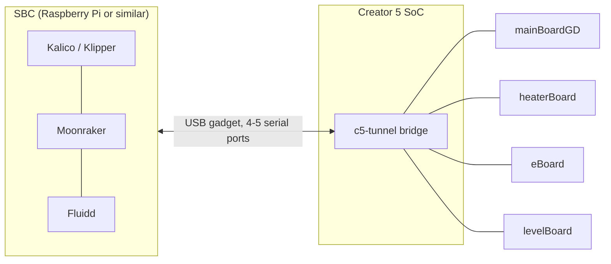

# SBC Installation and Configuration

SBC / RPI Klipper for replacing the Mips32 Host that comes with the printer.
The printer's own board keeps only a serial bridge that forwards its four MCUs
to the SBC over one USB cable. Klipper, Moonraker and Fluidd run on the SBC.



## Why go SBC

### Reasons to go OpenCreator SBC over stock

<div class="grid cards" markdown>

-   :material-flash: **More power**

    ---

    Run fun projects, add more cameras, add monitoring with AI, etc.

-   :material-timer-sand-complete: **Faster toolchanges**

    ---

    Toolchanges are half a second to a second faster, since Klipper runs on
    the SBC's much faster CPU instead of the printer's.

-   :material-shield-lock: **Security**

    ---

    Airgap the printer's old kernel version and potentially insecure packages,
    so they are only reached through the SBC.

-   :material-monitor: **Your choice of touchscreen**

    ---

    Use different touchscreen apps, such as KlipperScreen instead of GrumpyScreen.

-   :material-tools: **Standard tooling**

    ---

    Use KIAUH to install utilities instead of manually, run ShakeTune natively,
    and have all the support of a good architecture.

</div>

### What is the reason for development?

On the stock system, you have amazing MCUs, but the worst SOCs, to the point of encountering issues.
That wouldn't be normally an issue, manufacturers would put the minimum spec SOC, but FlashForge
demanded too much for how slow and not powerful the stock SOC is (Ingenic x2600). It frequently
runs into weirdness: even completely stock, with the stock touchscreen, you can't really print too
fast with toolchanges and no prime tower, as it will hit **Timer Too Close**, which happens when the
host (the SOC) can't catch up and falls behind. On 1.9.9 they even forced it to slow down to prevent this.

On OpenCreator SBC, Timer Too Close becomes a thing of the past, and you can run almost anything, as you're
running on a Raspberry Pi or similar microcomputer that has several times the power of the stock board.

## Requirements

- [ ] A SBC that has USB Gadget Mode support (Pi Zero 2 W, Pi 4/5 on its USB-C power port, etc)
- [ ] If using an external power supply on a Pi 4/5, a USB power and data splitter
- [ ] If using an external power supply on a Pi 4/5, a USB-A power blocker for the USB data in/out port on the splitter
- [ ] A recent Debian / Raspberry Pi OS Lite with up-to-date packages (headless / server installs recommended)
- [ ] If running a slow device (1 GHz Pi Zero 2 W), an overclock to 1.2 GHz or above
- [ ] Some type of cooling
- [ ] At least 4GB of storage
- [ ] At least 512MB of RAM
- [ ] Internet on at least the SBC

## Caveats

!!! warning "Camera"
    The camera will not work if you airgap the MCUs. You will have to make a custom connector or add
    your own camera (in testing to rectify). The camera may also slow down during fast movements due to
    the USB bus being overloaded; if that persists it may need to be restarted.

!!! warning "Cables"
    A USB to spec cable is recommended, and as short as possible to keep signal integrity. Even if a
    cable looks good, that doesn't mean it actually is.

!!! note "Wi-Fi on the printer"
    Unplugging / restarting the Pi causes the FlashForge printer's SoC to disconnect from Wi-Fi. It
    selects the virtual interface as internet and dies when it loses it.

!!! note "No FlashForge integration"
    Obviously, no FlashForge cloud or app integration at all.

??? info "4 or 5 tunnel ports"
    The USB gadget tunnel normally runs 5 ports (4 MCUs + a dedicated beep channel). Not every board's
    USB controller tolerates this under sustained traffic: it is confirmed stable on a Raspberry Pi 4
    (dwc2), but an Orange Pi Zero 2W's own controller destabilized the whole bus, and was stable at 4.

    The gadget script falls back to 4 ports automatically if the 5-port bind fails outright at boot,
    and pins that choice for future boots. A failure that only shows up at runtime isn't detectable
    that way and still needs a manual pin:

    ```sh
    echo 4 | sudo tee /etc/c5-tunnel-ports
    ```

    Pinned to 4 ports, `C5_BUZZER` can optionally fall back to sending the beep over the network
    instead of going silent; see `network_host` in `[creator5_remote_beeper]`.

## Installation

### On the printer

1. Make sure the printer is on FlashForge firmware 1.9.9, then plug in the
   [OpenCreator Installer](installer.md) media as outlined on the [installation page](installation-and-safety.md)
2. Click to use "Tunneled", and choose whether to install the GrumpyScreen touchscreen
3. Wait for installation to finish. The printer needs internet: it installs Entware, LoopScript
   and the socat bridge ([details](installer.md#what-gets-installed))
4. Restart your printer
5. If you installed GrumpyScreen, it opens up for a Moonraker printer. Edit
   `/usr/data/grumpyscreen/grumpyscreen.cfg` and set `host:` under `[moonraker]` to your
   Pi's IP address

### On the SBC

1. Plug in the SBC through the Gadget Mode port (USB-C on RPi 4/5, power micro USB for 3B+ and Zero 2 W).
2. Install the software:

=== "Automatic (recommended)"

    As your normal user (not root):

    ```sh
    curl -fsSL https://raw.githubusercontent.com/FlashForge-C5-Modding-Group/opencreator-tunnel/main/pi/install.sh | sh
    ```

    This installs, in order: the tunnel repository, Fluidd, Moonraker, Kalico, the printer config,
    the [OpenCreator Updater](#opencreator-updater) and the USB gadget service. An existing
    `printer.cfg` is left alone. On a first install, reboot afterwards so the USB gadget comes up.

=== "Manual"

    1. Set up Klipper (or Kalico), Moonraker, and Fluidd/Mainsail (Fluidd recommended).
    2. Clone [opencreator-tunnel](https://github.com/FlashForge-C5-Modding-Group/opencreator-tunnel).
    3. Run `sudo sh pi/setup-gadget.sh` to install the gadget service if on RPi 3B+, 4, 5 or Zero 2 W.
       On another SBC, set up a gadget tunnel based on that service.
    4. Copy the configs from `pi/config` into `~/printer_data/config` (plus `pi/kalico` if you use Kalico).
    5. Reboot, then restart the firmware for Klipper. It should connect if you did the printer first.

## What you get on SBC

### OpenCreator Updater

An "opencreator-updater" entry in Fluidd's update manager. One click pulls the latest config and
Klipper, and merges config changes into yours without overwriting values you customized. A
change that conflicts with yours is written next to the file as `<file>.conflict` for you to
look at, never into the live config.

!!! tip "Fluidd says \"No git repo detected\" for opencreator-updater"
    Run the repair script as your normal user:

    ```sh
    sh ~/opencreator-tunnel/pi/opencreator-updater/repair.sh
    ```

    It works wherever the repository is, starts git in a copied folder that has none, syncs to
    the official `main` branch (local edits are stashed, not deleted), fixes the
    `moonraker.conf` section and restarts Moonraker.

### 3MF uploads

Sliced 3MF files (OrcaSlicer or Bambu Studio "Export plate sliced file", `.gcode.3mf`) can be
uploaded straight to Fluidd or from the slicer. The first sliced plate is extracted as G-code with
its preview thumbnail. A 3MF with no sliced G-code is rejected.

### OpenCreator Fluidd theme

An extra-dark Fluidd theme with the OpenCreator logo and orange accents is installed into
`~/printer_data/config/.fluidd-theme/`. It is made for Fluidd's dark mode. To go back to stock
Fluidd, delete or rename `.fluidd-theme/custom.css` and reload the page.

### Kalico

SBC installs run [Kalico](https://github.com/FlashForge-C5-Modding-Group/kalico), which adds MPC
heater control (`C5_MPC_CALIBRATE`) on top of everything the Klipper port does.

## Extra notes

The touchscreen might feel physically slow no matter the device unless you use GrumpyScreen or
similar running locally on the printer itself. Streaming KlipperScreen to the printer's own screen
over VNC (instead of running GrumpyScreen) was attempted but is not currently working: a second,
isolated headless KlipperScreen instance (matched to the printer panel's resolution, so the VNC
feed needs no scaling) hangs indefinitely during its own window setup under cage's headless Wayland
backend, for reasons not yet root-caused. GrumpyScreen remains the supported local touchscreen option.

This could be fixed by using a touchscreen out from the SBC, such as something
[like this](https://www.aliexpress.com/item/1005007273964563.html).
