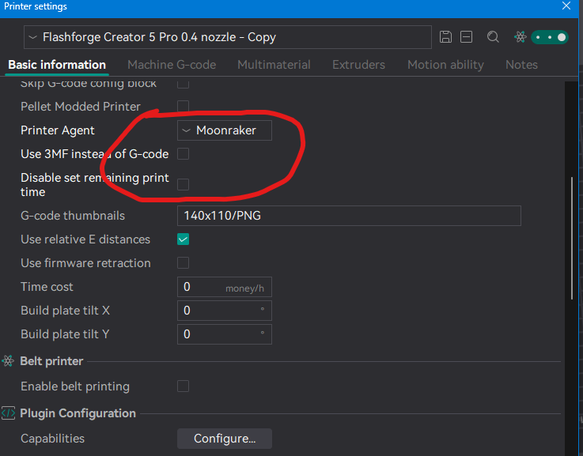

# Slicer Configuration for Orca / Flash Studio

A collection of configurations and settings for Custom Firmware OpenCreator.

## New - OrcaSlicer Cloud Profile
For those who do not want to do this manually, we now have an Orca Cloud Profile!
Check it out [here](https://cloud.orcaslicer.com/b/4e8284d5f077)

## Print profile

- [x] Under **Quality → Precision**, switch `Arc fitting` **off**.

    This improves performance with no quality loss, as arcs are not
    supported under Klipper.

- [x] Under **Others → G-code output**, switch `Label objects` and `Exclude objects` **on**.

    This lets adaptive bed meshing work correctly, and lets you exclude objects from the
    touchscreen and Fluidd/Mainsail.

## Printer profile

These will change stuff like printer agents.

### Connection

- [x] Click the Wi-Fi connect button (next to the printer) and change the host type to `Moonraker`.
- [x] Remove any serial numbers or API keys.

### Printer settings

- [x] **Printer Agent:** switch to `Moonraker`.
- [x] **Use 3MF instead of G-code:** switch from `on` to `off`.
- [x] **Disable set remaining print time:** `off`.

[{ .oc-shot loading=lazy }](assets/images/orca-printer-settings.png)

!!! tip "3MFs"
     .gcode.3mf files will get automatically changed to normal .gcode on upload, so to optimize file size uploading, you may use it.
     This has a downside of unzip / parse time being much higher, but the time you save via internet uploading could be worth it.

### Machine G-code

- [x] **File start G-code:** clear it (leave it empty).
  The FlashForge profile puts a FlashForge-style time estimate there, and Orca
  also copies that setting into the end of the file, where Moonraker reads it
  instead of the real estimate. With it in place, Fluidd and Mainsail show no
  slicer time estimate.

!!! note "Files sliced before the change"
    OpenCreator's Moonraker component works around this for files uploaded from
    now on. Files already on the printer show no estimate until you upload them
    again.

- [x] **Remove or comment out some G-code Print Start (Older versions of the profile):**

    `LINE_PURGE G1 X256 Y0 Z0.2 F6000`

    `G1 E5 F{filament_max_volumetric_speed[initial_no_support_extruder]/2.4053*60}`

    `G1 X216 E10 F{filament_max_volumetric_speed[initial_no_support_extruder]/2.4053*60}`

- [x] **Remove or comment out some G-code Print Start (Newer versions of the profile):**
    `G1 X256 Y0 Z0.2 F6000`

    `G1 E5 F{filament_max_volumetric_speed[initial_no_support_extruder]/2.4053*60}`

    ` G1 X216 E10 F{filament_max_volumetric_speed[initial_no_support_extruder]/2.4053*60}`

- [x] **Remove or comment out some G-code Print End (Newer versions of the profile):**
    `G1 X150 Y150 E-1.2 F12000`

- [x] **Layer change G-code (optional, for timelapses):** add
  `TIMELAPSE_TAKE_FRAME` on its own line, so [Timelapse](printer-features.md#timelapse)
  takes a frame at every layer.

## Optional / niceties

!!! tip "Faster retractions"
    Set retraction and deretraction speed to 45 on all extruders. It should make it much faster,
    and doesn't seem to cause much stringing.

!!! tip "Lower Z-hop"
    Set Z-hop height to 0.3 on all extruders. It reduces stress on the Z axis and makes your
    prints slightly faster.
